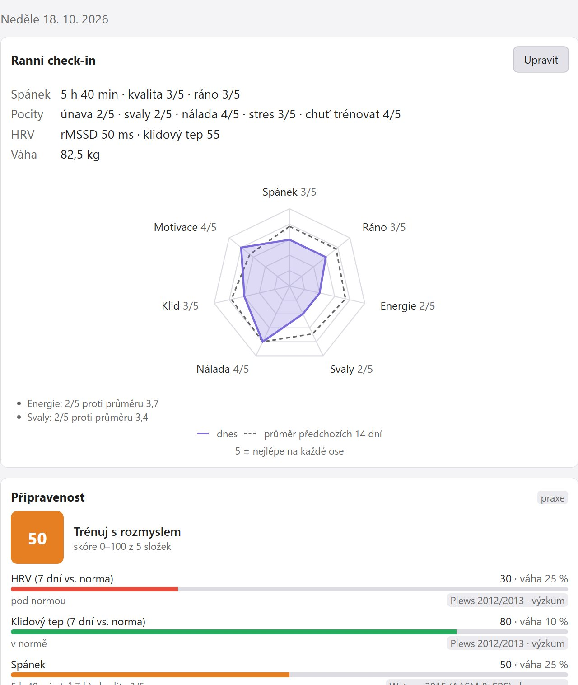
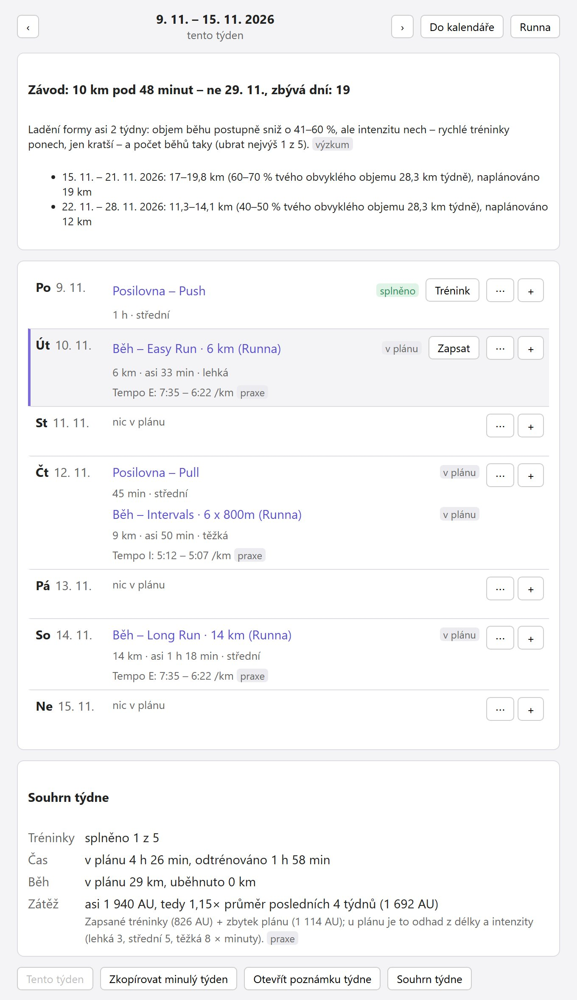
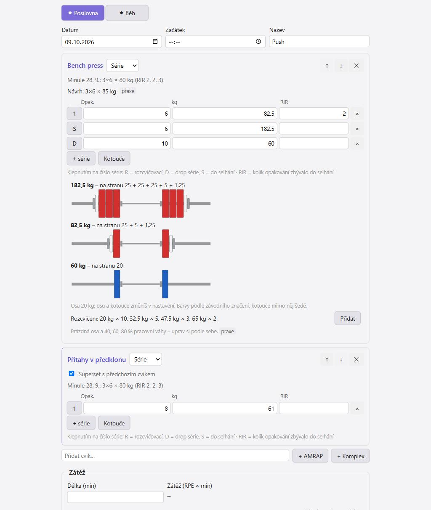
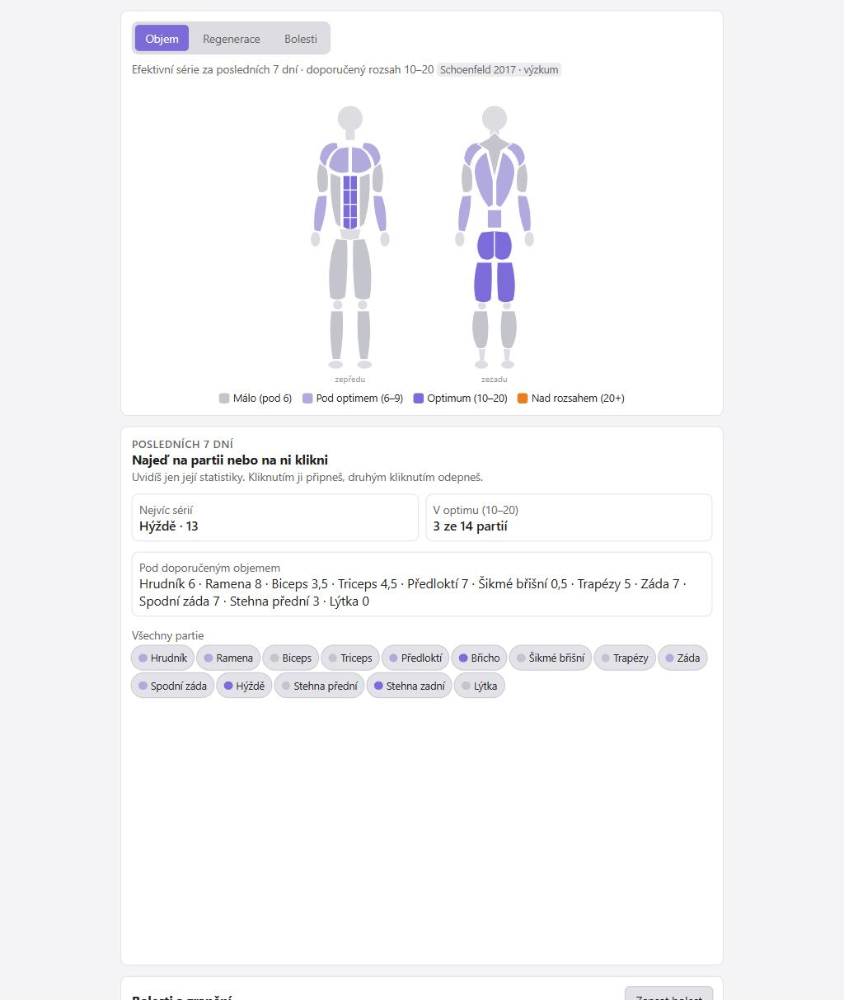
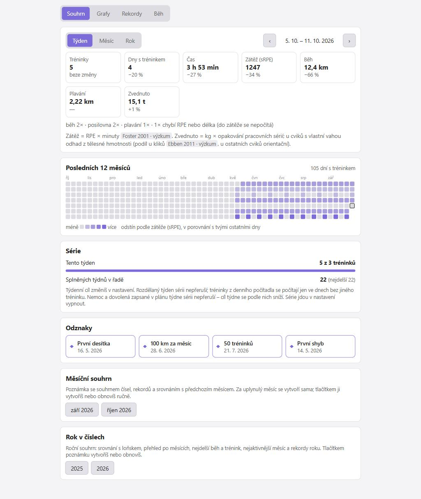
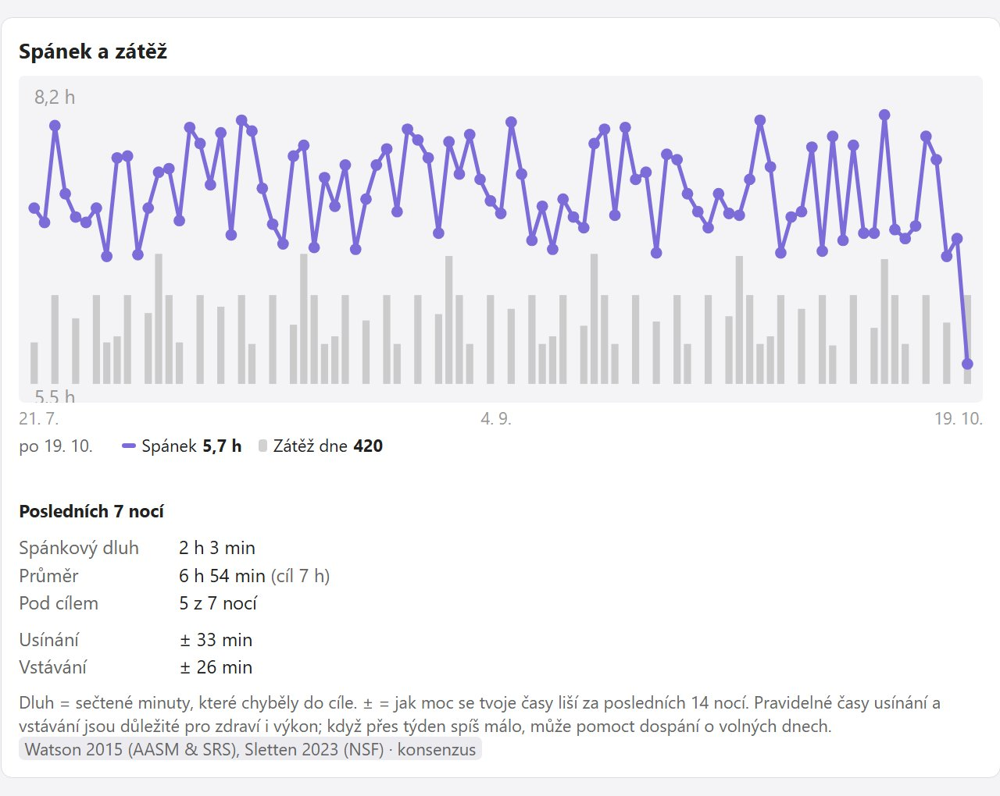
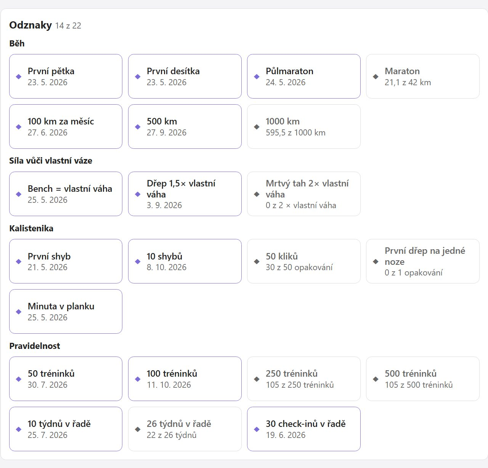
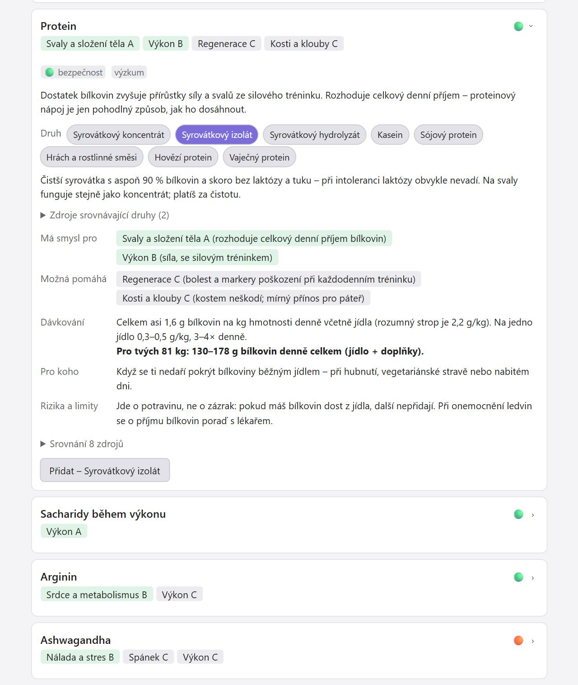
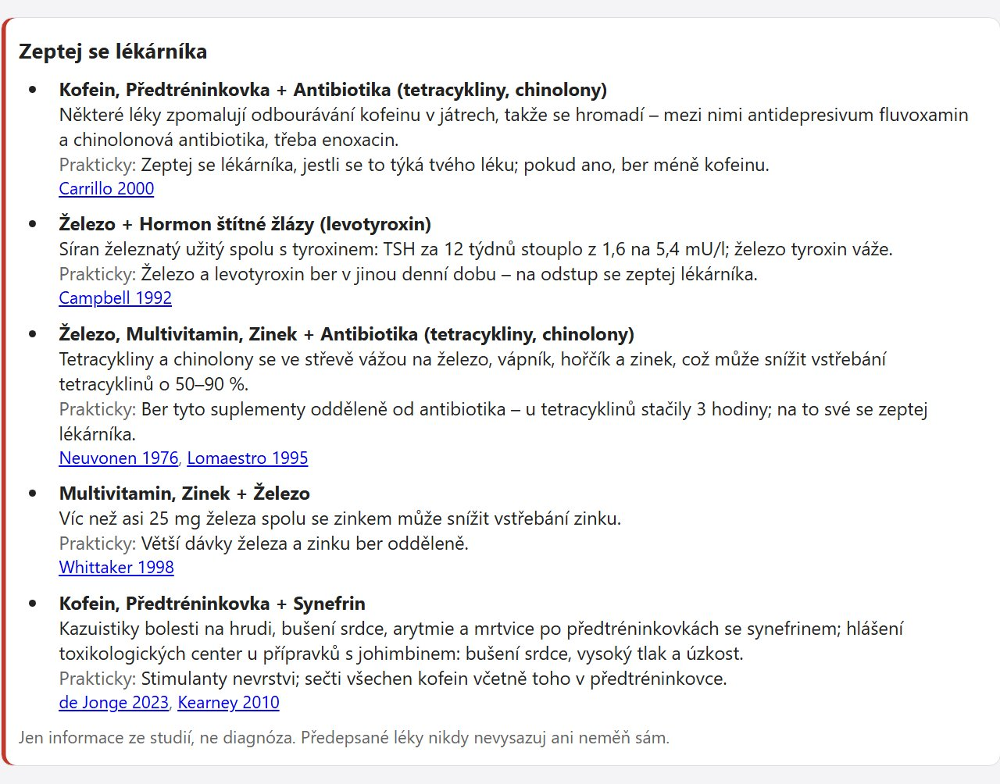
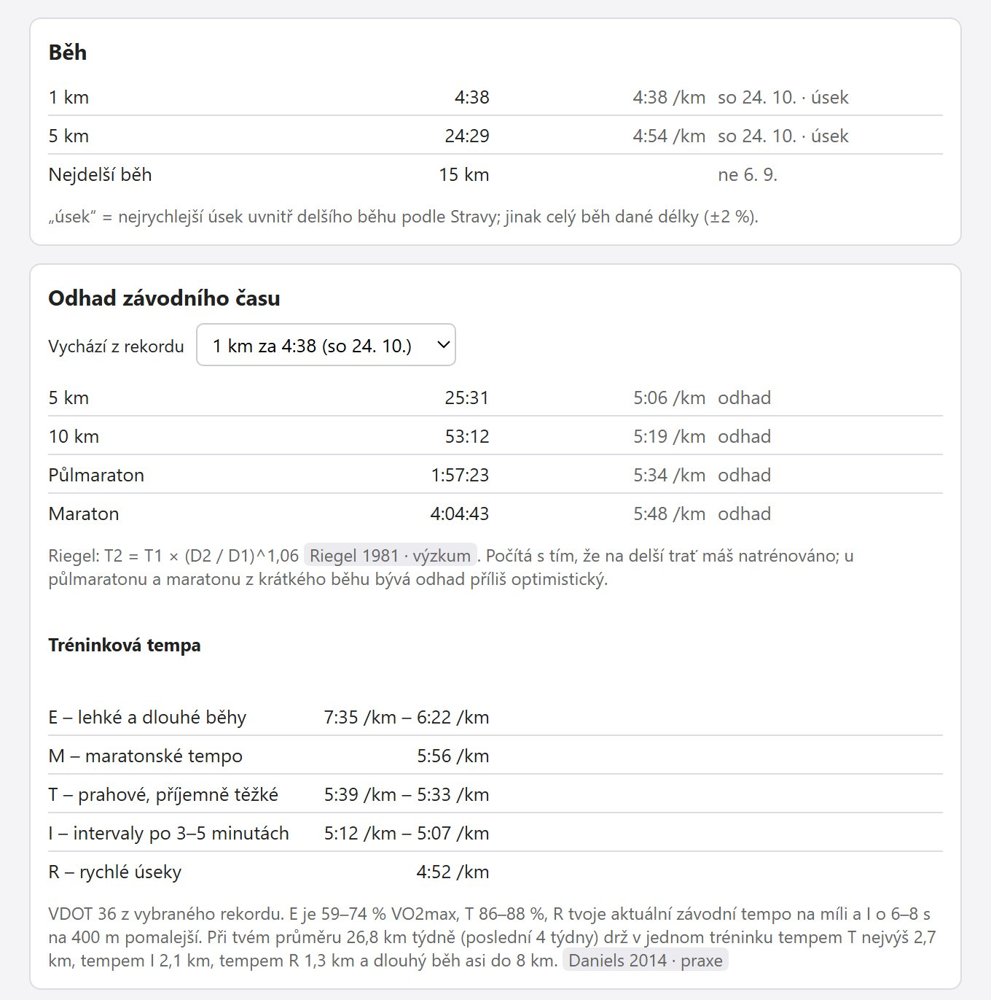

# Better Form

[English](README.md) · **Česky**

**Tréninkový deník pro [Obsidian](https://obsidian.md), který ukazuje, odkud jeho rady jsou.** Trénink zapíšeš za minutu a ranní check-in za půl minuty. Plugin z nich spočítá připravenost na den, doporučení, plán týdne a doporučený denní příjem – a u každého čísla uvidíš, odkud je.

- **Data zůstávají tvoje.** Každý trénink i den je běžná Markdown poznámka ve tvém vaultu, čitelná i bez pluginu. Offline, bez účtu, telemetrie a reklam.
- **Rady, které si můžeš ověřit.** Každé doporučení a výpočet ukazuje zdroj a jestli stojí na výzkumu, konsenzu, nebo trenérské praxi – 953 ověřených zdrojů, z toho 30 knih o tréninku a sportovní výživě.
- **Trénink, regenerace a výživa na jednom místě.** Posilovna, kalistenika, kettlebell, běh, plavání a švihadlo; připravenost ze spánku, HRV a tréninkové zátěže; doporučený příjem, který nikdy neklesne pod klidový výdej.

> **Stav:** verze 0.5.0, v katalogu komunitních pluginů, ve vývoji. Běží na počítači i na telefonu. Výpočty kryjí automatické testy, v Obsidianu je ale zatím vyzkoušená jen část funkcí a na telefonu jen několik – viz [Stav ověření](#stav-ověření). Rozhraní je anglicky a česky.

## Ukázky

Vzorová data, světlý vzhled, české rozhraní.

| Dnes | Plán týdne |
|---|---|
|  |  |

| Zápis tréninku | Tělo |
|---|---|
|  |  |

| Přehled | Týden spánku |
|---|---|
|  |  |

| Odznaky | Katalog suplementů |
|---|---|
|  |  |

| Bezpečnost suplementů | Tréninková tempa |
|---|---|
|  |  |

## Jak začít

Potřebuješ Obsidian 1.13 nebo novější (starší verze zůstanou u Better Form 0.3.2).

1. **Instalace:** Nastavení → Komunitní pluginy → **Procházet**, vyhledej **Better Form**, **Instalovat** a **Povolit**. Aktualizace najdeš v Nastavení → Komunitní pluginy → Zkontrolovat aktualizace. (V katalogu je poznámka, že plugin prošel automatickými kontrolami, ale tým Obsidianu ho neprošel ručně.)
2. **Nastavení:** po prvním zapnutí se otevře krátký průvodce – pohlaví, rok narození, výška, hmotnost, cíl a sporty. Plugin založí složky, knihovnu cviků a předpřipravené programy. Znovu ho spustíš příkazem „Průvodce nastavením“.
3. **Otevři panel** ikonou činky v levé liště nebo příkazem „Otevřít přehled“.
4. **Každý den:** ráno vyplň **check-in**, po tréninku **Zapsat trénink** s RPE (pocit náročnosti 0–10) a délkou – z nich se počítá zátěž, připravenost i doporučení.

Přehledy se plní postupně; dokud není dost dat, uvidíš „sbírám data (X z Y dní)“ místo prázdného grafu. Po aktualizaci doplní příkaz „Doplnit knihovnu cviků, programy a šablony“ nový vestavěný obsah a tvoje poznámky nechá beze změny.

**Ruční instalace:** stáhni `main.js`, `manifest.json` a `styles.css` z [posledního vydání](https://github.com/ssestorad/Better-Form/releases/latest) (nebo je sestav, viz [Vývoj](#vývoj)), zkopíruj je do `<vault>/.obsidian/plugins/better-form/` a zapni **Better Form** v Nastavení → Komunitní pluginy.

### Na telefonu

Plugin funguje v Obsidianu pro Android i iOS; na telefonu se panel obvykle otevře v postranní liště.

- **Klepnutí místo najetí myší:** kde počítač ukáže doplňující informaci po najetí myší (datum rekordu, podrobnosti řádku tabulky), na telefonu na ni klepni – text se ukáže jako hláška.
- **Strava** se přihlašuje vložením kódu místo místního serveru, který používá počítač; nastavení tě tím provede. Garmin Connect, Runna i importy ze souboru fungují stejně jako na počítači.
- **Rychlé odkazy:** Nastavení → Better Form → Rychlé odkazy pro telefon nabízí hotové odkazy `obsidian://better-form?…` (check-in, zápis tréninku nebo šablony, přičtení do denního počítadla, synchronizace) pro zástupce na ploše nebo Zkratky v iOS. Příkazy jdou dát i do mobilní lišty (nastavení Obsidianu → Lišta nástrojů).
- **Když se karta nedá zobrazit,** uvidíš místo prázdné plochy rámeček s textem chyby – pošli ho autorovi ([issue na GitHubu](https://github.com/ssestorad/Better-Form/issues)), přesně z něj pozná, co selhalo.

## Co najdeš na kartách

Části, které nepoužíváš, jde vypnout v Nastavení → Moduly (i v průvodci) – celou kartu jako Suplementy nebo Výživa, nebo menší část jako panáčka či tlačítko Runna. Nic se nesmaže. Deník bolesti vypnout nejde.

Panel má pro každou oblast jednu kartu. Tlačítko **Knihovna cviků** vedle nadpisu každé karty otevře knihovnu odkudkoli, každé nastavení najde hledání v nastavení Obsidianu a hlavní akce jsou i v paletě příkazů (Ctrl+P).

### Dnes

- **Ranní check-in** do půl minuty – spánek, pocity, chuť trénovat, HRV, klidový tep, váha, kroky, nepovinně tělesné míry. Paprskový graf porovná dnešek s posledními 14 dny.
- **Připravenost** (0–100) s rozpadem a trendem za 14 dní.
- **Doporučení** se zdůvodněním a zdroji – spánek, HRV, skoky v zátěži, regenerace partií, bolest, deload, cíle, plán týdne, výživa. Třeba naplánovaný běh o víc než 10 % delší než tvůj nejdelší běh za posledních 30 dní dostane upozornění.
- **Deník návyků** – zaškrtni včerejší návyky (alkohol, kofein po 14. hodině, pozdní jídlo, obrazovka před spaním, cestování – seznam jde upravit). Jakmile je za posledních 90 dní aspoň 5 dní s návykem a 5 bez něj, karta ukáže, jak se lišilo další ráno (HRV, klidový tep, spánek, pocity) – souvislost, ne příčina.
- **Spánkový dluh** za posledních 7 nocí (jakmile jsou zapsané aspoň 4 noci), dnešní plán, dnešní tréninky a výživa na dnešek.

### Zapsat

- **Tréninky** – posilovna, kalistenika, kettlebell, běh, plavání, švihadlo. Série, výdrže, EMOM, AMRAP, žebříky, komplexy, supersety; rozcvičovací a drop série a série do selhání; šablony (i protažení po běhu, po posilování a mobilita) a „z minula“ s návrhem navýšení; kalkulačka kotoučů s návrhem rozcvičení.
- **Běhy k doplnění** – běhy importované ze souboru, z Garmin Connect nebo ze Stravy, které čekají na RPE, typ běhu a boty.
- **Knihovna cviků** – 268 cviků s provedením, častými chybami, zapojenými partiemi, potřebným vybavením (s filtrem) a **náhradami** na stejné svaly, když je stroj obsazený. U každého cviku je historie tvých výkonů s grafem; vlastní cviky jdou přidat.

### Plán

- **Týden po dnech** – tréninky naplánované dopředu, které se samy odškrtnou podle zapsaných tréninků, včetně dnů aktivních programů; u programů se střídajícími se tréninky plán ukáže, který je na řadě (trénink A, B nebo C).
- **Plán z Runny** – tvůj tréninkový plán z Runny na příští 4 týdny, načtený z odkazu na její kalendář (funguje i s jinými trenérskými aplikacemi, které nabízejí odkaz iCal).
- **Cílové tempo** u naplánovaných běhů podle Jacka Danielse z tvého nejnovějšího rekordu – lehké, prahové, intervalové nebo tempo úseků podle názvu a intenzity tréninku.
- **Ladění formy před závodem** – když má cíl „čas na trati“ termín do 3 týdnů, plán ukáže, jak ladit poslední 2 týdny: objem běhu postupně o 41–60 % dolů, intenzita a počet běhů zůstanou, a kolik máš naplánováno.
- **Výhled zátěže** proti posledním čtyřem týdnům a upozornění na naplánovaný běh, který je mnohem delší než obvykle.
- **Úpravy běhu** – u dnešního a zítřejšího běhu plán navrhne změnu i s důvodem: při bolesti nohou 4/10 a víc běh vynechat, při mírnější bolesti lehce a kratší, v den s nízkou připraveností lehce a vynechané běhy nedohánět. Jen návrh, plán zůstane, jak je.
- **Volno, nemoc a dovolená** položky jen odloží a série nepřeruší.
- **Do kalendáře** uloží týden jako soubor `.ics` pro kalendář Google, Outlook nebo Apple; opakovaný import události aktualizuje, nezdvojí. Tréninky načtené z Runny se vynechají – v kalendáři už jsou.
- **Do hodinek** uloží nadcházející běhy týdne jako tréninky `.fit` s cílovým tempem – do Garminu je zkopíruj přes USB (`GARMIN/NewFiles`) nebo naimportuj v aplikaci výrobce hodinek. Každý běh je jeden krok; intervaly se nerozdělují.

### Přehled

- **Souhrn** – týden, měsíc a rok v číslech, kalendář tréninků za 12 měsíců, série (splněné týdny v řadě) a 22 odznaků za běh, sílu vůči vlastní váze, kalisteniku a pravidelnost; poznámky s měsíčním a ročním souhrnem.
- **Grafy** – zátěž, kondice a únava; tempo a kadence běhu; odhad 1RM; spánek a zátěž s posledními 7 nocemi (spánkový dluh a pravidelnost spánku – cíl nastavíš v Pokročilé → HRV a spánek); váha s trendovou váhou; HRV.
- **Rekordy**, odhad závodního času a **tréninková tempa** podle Jacka Danielse (lehké, maratonské, prahové, intervalové a tempo úseků z vybraného rekordu) s limity rychlého běhu podle tvého týdenního objemu.
- **Běh** – tepové zóny, rozložení intenzit 80/20, boty a jejich nájezd.

### Tělo

- **Panáček** s týdenním objemem a regenerací svalových partií – zvýraznění nikdy nemění rozvržení.
- **Evidence bolestí a zranění** s jejich průběhem; u bolesti od 4/10 nebo trvající přes 7 dní plugin doporučí odborníka.
- **Tělesné míry**.

### Dovednosti, Programy a Cíle

- **Dovednosti** – žebříčky kalisteniky: shyby, kliky, dřep na jedné noze, stojka, front lever, planche…
- **Programy** – vlastní i 14 předpřipravených (Základ 4, Od gauče k 5 km, První shyb, 100 kliků denně, Grease the groove, Síla od nuly 3×5, Kettlebell – Program Minimum a Simple & Sinister, švihadlo…), denní počítadlo a testy maxim. Tréninky se můžou střídat v pořadí – A/B nebo A/B/C – bez ohledu na den v týdnu. Program jde vytvořit i ze souboru nebo z vloženého textu.
- **Cíle a normy** – čas na trati, síla, opakování, váha nebo vlastní tabulky norem, s předpovědí podle trendu.

### Výživa

- **Doporučený denní příjem** a makroživiny podle klidového výdeje, běžné aktivity, tréninků a cíle, s výpočtem krok po kroku.
- **Pojistky** proti příliš nízkému příjmu a **kontrola podle vývoje váhy** s úpravou jedním klepnutím.
- **Trendová váha** vyhladí denní výkyvy; s cílem na váhu karta odhadne, kdy ho dosáhneš. Fáze hubnutí nebo nabírání může mít datum konce (Nastavení → Profil → Cíl platí do), potom se výživa přepne na udržování.
- Zápis jídla plugin nemá.

### Suplementy

- **Co bereš** a jak pravidelně, s denním součtem a horními limity, i když je stejná látka ve více přípravcích.
- **Katalog 94 látek** – důkazy hodnocené zvlášť pro každou oblast přínosu (výkon, regenerace, spánek, srdce a metabolismus…), dávkování podle tvé hmotnosti, rizika a hodnocení bezpečnosti; každá látka porovnaná nejméně ze čtyř zdrojů, studie placené výrobcem označené. U proteinu, hořčíku, kreatinu, omega-3, vitaminu D, zinku, železa, vápníku, kurkuminu a sacharidů si vybereš druh (syrovátkový izolát nebo kasein, citrát nebo glycinát hořčíku…).
- **Bezpečnost** – zaškrtneš skupiny léků, které bereš (Nastavení → Profil → Léky, které užívám), a plugin zvýrazní interakce s tvými suplementy i kombinace tvých suplementů, které se k sobě nehodí. Část pro závodníky shrnuje kontaminované přípravky, nezávislé testování a stav podle WADA 2026. Jen informace, ne diagnóza.
- **Tabulky** – aminokyseliny, elektrolyty a tekutiny, kofein, doporučený příjem a horní limity.
- **Osobní test** – porovná spánek a pocity, odhad 1RM nebo tempo běhu za čtyři týdny před suplementem s týdny během užívání.
- **Vlastní přípravky** podle etikety: přiložíš fotku, vložíš text složení a plugin z něj vyčte látky.

### Režim Základ

Zjednodušená obrazovka s pár cviky a během pro toho, kdo nechce nic nastavovat.

## Odkud jsou rady

Každé doporučení a výpočet ukazuje zdroj a štítek důkazů:

- **výzkum** – opírá se o studie nebo metaanalýzy,
- **konsenzus** – stanoviska odborných společností,
- **praxe** – zavedená trenérská heuristika bez vlastní studie.

Heuristika se nikdy nevydává za výzkum. Katalog má 953 zdrojů, každý před přidáním ověřený podle původní práce. Knihy mají štítek praxe a u každé je napsané, jak byl obsah ověřen – v textu knihy (hledání v knihovním výtisku), podle obsahu nebo podle popisu vydavatele.

Karty **Co říká výzkum** shrnují 34 témat – co studie zjistily, co si z toho vzít do tréninku a samotné studie – a karty **Trenérská praxe** dalších 8 z trenérských knih. Najdeš je tam, kde se hodí:

| Kde | Témata |
|---|---|
| Detail cviku | objem a frekvence, technika a tempo, pauzy mezi sériemi, samotný cvik (dřep, mrtvý tah, tlaky, přítahy, hýždě, kettlebell, střed těla, rozsah pohybu); u cviků mobility rozcvička a strečink, pohyblivost. Praxe: techniky sérií (drop série, supersety, předvyčerpání…) a tři cesty k síle u cviků v posilovně, progrese s vlastní vahou u kalisteniky, kompenzační cvičení u cviků mobility, planku, bočního vzporu a bird dogu |
| Programy | např. Od gauče k 5 km: začátky s během, silový trénink pro běžce, běžecká zranění |
| Přehled → Grafy | zátěž a riziko zranění, posilování a zdraví, spánek a trénink, trénink ráno, nebo večer, trénink řízený podle HRV; praxe: zatížení, zotavení a superkompenzace |
| Přehled → Běh | běh 80/20, silový trénink pro běžce, posilování a vytrvalost dohromady, HIIT proti klidnému kardiu, běžecká zranění |
| Dnes | menstruační cyklus (při ženském pohlaví v profilu) |
| Výživa | bílkoviny, hubnutí bez ztráty svalů (při cíli „Hubnutí“), kroky a zdraví, alkohol, pitný režim; praxe: energetická dostupnost |
| Suplementy → Knihovna | praxe: nejdřív jídlo, důkazy a kontaminované suplementy (z učebnic sportovní výživy) |
| Tělo | regenerační metody, trénink při bolesti |

## Import a export

### Běhy ze souboru (bez předplatného)

Tlačítko **Ze souboru** na kartě Dnes nebo Zapsat, případně příkaz „Importovat běh ze souboru (GPX, TCX, FIT)“. Vybrat jde víc souborů najednou.

- **Strava:** na strava.com otevři aktivitu → tři tečky → Export GPX (funguje i s účtem zdarma; mobilní aplikace export nemá).
- **MapMyRun:** na mapmyrun.com otevři trénink → tři tečky → Download as TCX.
- **Hodinky a jiné aplikace:** většina umí export GPX, TCX nebo FIT.

Plugin načte datum a čas, vzdálenost, čas v pohybu, tep a kadenci (pokud v souboru jsou), převýšení a nejrychlejší úseky od 1 km po maraton. Tentýž soubor podruhé se přeskočí a ručně zapsaný běh ze stejného dne se stejnou vzdáleností se jen doplní o měřené údaje. Vzdálenost se počítá z poloh GPS, takže se od aplikace může o pár procent lišit.

### Garmin Connect

Garmin umožňuje vytvořit si zdarma osobní klíč ke čtení vlastních dat (Garmin Connect na webu → Personal API Key); nastavení pluginu v Import dat → Garmin Connect tě tím provede. Tlačítko **Synchronizovat Garmin** na kartě Dnes nebo Zapsat pak přinese:

- **denní data** – kroky, délku spánku a časy usnutí a probuzení, klidový tep a váhu; doplní se jen to, co v deníku chybí,
- **běhy** – stažené jako soubory FIT, s tepem, kadencí a nejrychlejšími úseky; běh, který už v deníku je (ze Stravy nebo zapsaný ručně), se nezdvojí,
- **HRV** jen když ho zapneš – hodinky měří průměr přes noc, což je jiné měření než ranní (Elonga, hrudní pás), a smíchání by pokazilo tvoji osobní normu.

Přístup je jen ke čtení, synchronizace běží jen, když ji spustíš, funguje i na mobilu a klíč zůstává v souboru `data.json` pluginu ve tvém vaultu. Klíč platí nejvýš rok; až vyprší, vytvoř nový.

### Runna

Runna nemá veřejné API, ale plán sdílí jako soukromý odkaz na kalendář (Runna → Profil → Connected Apps & Devices → Calendars → Other Calendar). Vlož ho do nastavení pluginu v Import dat → Runna; tlačítko **Runna** na kartě Plán pak načte do plánu týdne příští 4 týdny. Naplánované tréninky z Runny se při každé synchronizaci aktualizují, minulé dny a tvoje vlastní položky zůstanou, jak jsou, a dokončené běhy přijdou jako obvykle z Garminu nebo ze Stravy – odškrtnou plán, započítají se do výhledu zátěže a hlídá je upozornění na mnohem delší běh. Vzdálenost a délka se čtou z názvu tréninku. Odkaz zůstává v souboru `data.json` pluginu ve tvém vaultu; kdo ho má, vidí tvůj plán.

### Synchronizace se Stravou

Od června 2026 Strava dovolí vytvořit API aplikaci jen účtům s **placeným předplatným**. Pokud ho máš, nastavení tě provede jejím založením i připojením účtu. Synchronizace běží jen, když ji spustíš, a přihlašovací údaje zůstávají v souboru `data.json` pluginu ve tvém vaultu. Vyzkoušená je proti skutečnému účtu, i na telefonu.

### Další data

- **Denní data z hodinek nebo telefonu** – kroky, délka spánku, HRV, klidový tep a váha z CSV, z Apple Health (`export.xml` z Exportovat všechna data zdraví) nebo z Health Auto Export (JSON nebo CSV); doplní jen to, co chybí. HRV z Apple Health je SDNN a neimportuje se. Android Health Connect vlastní export nemá – použij CSV z aplikace jako Health Sync.
- **Z jiného deníku** – historie silových tréninků z exportu Strong a Hevy (CSV). Nejdřív si to vyzkoušej na záloze.
- **Ven** – CSV pro Excel, záloha celé složky do ZIP, plán týdne jako kalendář `.ics` a naplánované běhy jako tréninky `.fit`.

## Tvoje data

Každý trénink, den, cvik, program nebo cíl je jedna poznámka s frontmatterem (`forma: workout`, `forma: day`, …). Plugin čte a zapisuje jen přes Obsidian API a nepotřebuje Dataview ani jiné pluginy. Všechny klíče popisuje [docs/schema.md](docs/schema.md) i s příklady pro Bases a Dataview. Volitelně plugin zapisuje metriky dne (`bf_readiness`, `bf_sleep_h`, `bf_hrv`, …) i do tvé vlastní denní poznámky – Nastavení → Metriky ve vlastní denní poznámce.

```
Better Form/
  Journal/      denní poznámky: spánek, check-in, HRV, váha, kroky
  Workouts/     jedna poznámka = jeden trénink
  Plan/         jedna poznámka = plán jednoho týdne
  Library/      cviky, šablony tréninků, programy, suplementy
  Goals/  Health/  Equipment/  Tests/  Summaries/  Export/
```

- Názvy složek jdou změnit v nastavení. Vaulty založené verzí 0.2 nebo starší si nechají české složky `Forma/`.
- Plugin **nikdy nepřepisuje tvůj text** – generovaný obsah patří jen mezi `<!-- forma:start -->` a `<!-- forma:end -->`. Mění jen svoje poznámky a v nich jen frontmatter a generovaný blok.
- Mazání z rozhraní přesune poznámku do koše podle nastavení Obsidianu, nikdy ji nesmaže natrvalo.
- **Síť:** plugin funguje offline a nic neodesílá. Jediná spojení jsou nepovinné synchronizace s Garmin Connect (`personal.connectapi.garmin.com`, jen čtení), kalendář Runny (odkaz, který vložíš, jen čtení) a se Stravou (`www.strava.com`) a všechny běží jen, když je spustíš. Při přihlášení ke Stravě plugin na počítači krátce spustí místní server na `127.0.0.1`, na mobilu kód vložíš ručně.
- Mimo vault nic nečte ani nezapisuje – importované soubory vybíráš sám a exporty i zálohy se ukládají do vaultu. Schránku použije jen po kliknutí na **Export** u karty programu nebo **Vložit ze schránky** v importu programu.

## Jazyk

Rozhraní je anglicky a česky. Při prvním spuštění se řídí jazykem Obsidianu; změníš ho v nastavení pluginu pod „Jazyk“. Přeložené je rozhraní, doporučení, generované bloky i vestavěná knihovna; co napíšeš sám, zůstane, jak jsi to napsal. Složky a názvy poznámek knihovny v novém vaultu jsou vždy anglicky. Vestavěné cviky mají názvy ve všech jazycích jako aliasy, takže odkazy i historie fungují i po přepnutí. Tlačítko **Přeložit poznámky** vedle nastavení jazyka přeloží vestavěnou knihovnu a generované texty v tvých poznámkách – texty, které jsi upravil, zůstanou. Názvy příkazů se změní po restartu Obsidianu.

## Upozornění

- **Není to zdravotnická aplikace.** Plugin nic nediagnostikuje. U bolesti od 4/10 nebo trvající déle než 7 dní doporučí odborníka – ber to vážně.
- **Výživa je odhad.** Rovnice mají přesnost zhruba ±10 % a doporučení nikdy neklesne pod klidový výdej. Jestli sedí, ukáže až vývoj váhy za 2–3 týdny.
- **Doporučení jsou vodítko** a nenahrazují trenéra, fyzioterapeuta ani lékaře.

### Stav ověření

**Vyzkoušené v Obsidianu na počítači:** zápis tréninku (i ze šablon), panáček, check-in a denní poznámka, plán týdne, Přehled, mazání; karta Suplementy včetně druhů, interakcí s léky, kombinací, části pro závodníky a osobního testu s výkonem; tlačítko knihovny cviků, filtr vybavení a náhrady cviků; paprskový graf check-inu, odznaky, spánkový dluh a pravidelnost; stránka nastavení přestavěná pro Obsidian 1.13; import GPX ze Stravy; upozornění na mnohem delší běh, graf kadence a export do kalendáře; anglické rozhraní a „Přeložit poznámky“ na existujícím českém vaultu.

**Vyzkoušené na telefonu (iPhone):** synchronizace se Stravou proti skutečnému API, úvodní průvodce a karta Výživa. Některé karty (Dnes, Plán, Suplementy) se na telefonu zobrazily prázdné – verze 0.5.0 v takovém případě ukáže text chyby, aby šla příčina najít a opravit.

**Jen automatickými testy a v náhledu:** karta Výživa, měsíční a roční souhrn; TCX, FIT a tep či kadence ze souboru, denní data z CSV a historie ze Strong a Hevy (jen na ručně sestavených souborech); tréninková tempa, střídání tréninků A/B/C, nové programy Síla od nuly 3×5 a Kettlebell – Program Minimum a karty Trenérská praxe (jen automatické testy); plán z odkazu na kalendář, cílová tempa v plánu a ladění formy před závodem (automatické testy a náhled).

**Zatím nevyzkoušené:** synchronizace s Garmin Connect proti skutečnému API, plán ze skutečného kalendáře Runny, ostatní karty na telefonu.

## Vývoj

Potřebuješ Node.js a npm (CI běží na Node 24).

```powershell
npm install
npm run dev        # sestavuje při každé změně; s VAULT_PATH v .env.local kopíruje rovnou do vaultu
npm run build      # kontrola typů + produkční sestavení
npm test           # testy (Vitest)
npm run deploy     # sestavení + kopie main.js, manifest.json, styles.css do <vault>/.obsidian/plugins/better-form/
npm run preview    # náhled vybraných obrazovek v prohlížeči s ukázkovými daty (tools/preview)
```

Pro nasazení zkopíruj `.env.local.example` do `.env.local` a vyplň `VAULT_PATH`. `.env.local` se nikdy necommituje.

| Složka | Obsah |
|---|---|
| `src/calc/`, `src/rules/` | výpočty a pravidla doporučení – čisté funkce bez závislosti na Obsidianu, každý vzorec má test |
| `src/data/` | čtení a zápis poznámek |
| `src/model/` | datový model poznámek (frontmatter) |
| `src/evidence/` | katalog zdrojů |
| `src/i18n/` | překlad: `t()` / `tn()` s tvary podle čísla a kontextem, volba jazyka |
| `src/locales/` | složka pro každý jazyk (klíč = anglický text nebo id vestavěného obsahu) a registr jazyků |
| `src/seed/` | knihovna cviků, programy, šablony, katalog suplementů, výzkum – anglický zdroj se stálými id |
| `src/ui/` | rozhraní (Svelte 5) |
| `tests/` | testy včetně datové vrstvy nad vaultem v paměti a synchronizací proti podvrženému serveru |
| `tools/preview/` | náhled vybraných obrazovek v prohlížeči s ukázkovými daty – kontrola rozvržení a snímky |

Každý push do `main` spustí na GitHub Actions testy, kontrolu typů a sestavení.

**Vydání:** zvyš verzi v `manifest.json` a `package.json`, do `versions.json` přidej `"<verze>": "<minAppVersion>"`, commitni a pushni tag se stejným číslem bez `v` (např. `git tag 0.2.2` a `git push public 0.2.2`). Workflow „Vydání“ ověří, že tag sedí se všemi třemi soubory, spustí testy a sestavení a vytvoří vydání s `main.js`, `manifest.json` a `styles.css`.

### Přidání jazyka

Zdrojový jazyk je angličtina: texty rozhraní i vestavěná knihovna se píšou anglicky přímo v kódu a každý další jazyk je překlad ve vlastní složce.

1. Zkopíruj `src/locales/cs/` do `src/locales/<kód>/` (třeba `de`) a v jeho `index.ts` nastav `code` a `label`.
2. Přelož hodnoty (nikdy klíče): `ui.ts` pro rozhraní, `exercises.ts`, `programs.ts`, `research.ts`, `supplements.ts`, `amino.ts` a `sources.ts` pro knihovnu. Tvary podle čísla se řídí `Intl.PluralRules` (`one`, `few`, `many`, `other`).
3. Zaregistruj jazyk jedním řádkem v `src/locales/index.ts`.
4. Spusť `npm test` – testy vypíšou každý chybějící nebo nesedící překlad. `I18N_DUMP=missing-{kód}.json npm test` zapíše chybějící texty rozhraní do souboru.

Jazyk se pak objeví v nastavení a vybere se sám, když ho používá Obsidian.

## Licence

MIT – viz [LICENSE](LICENSE).
