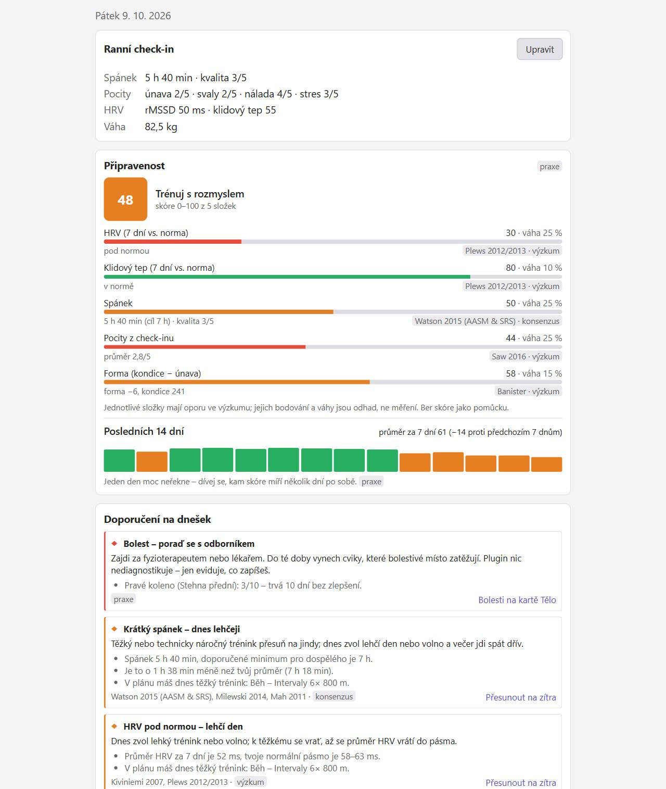
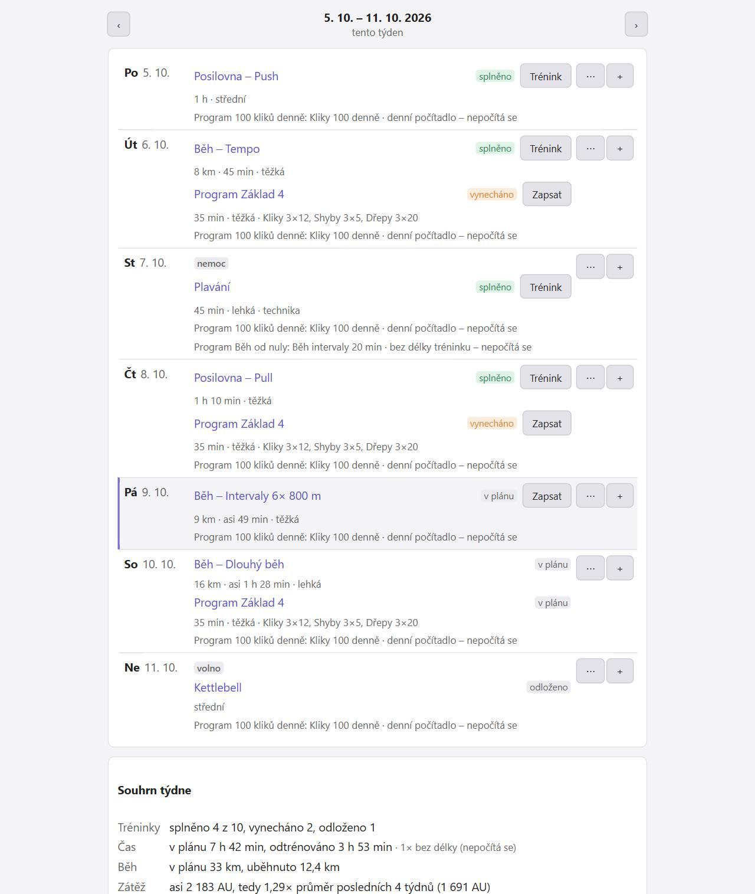
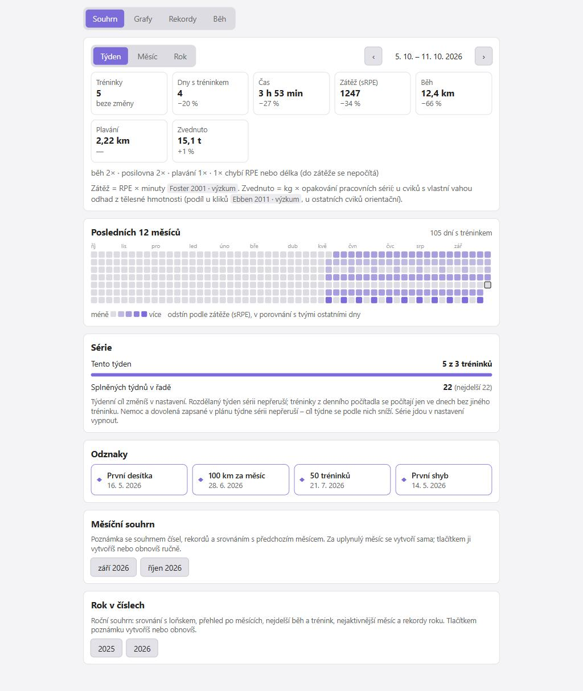
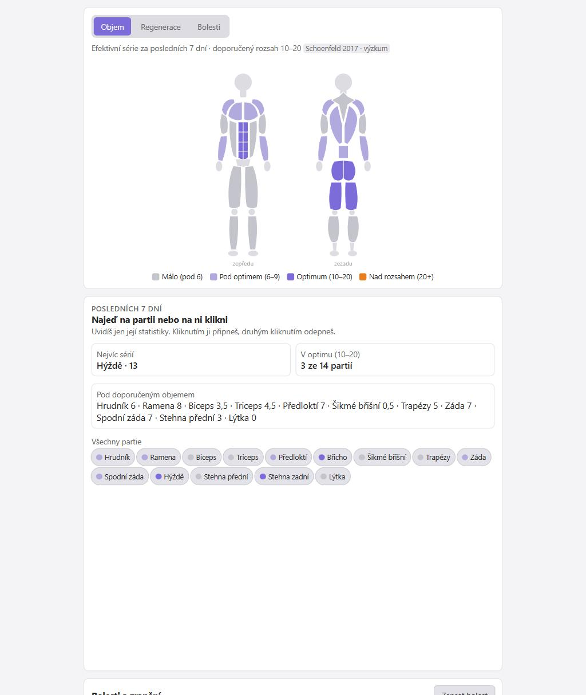
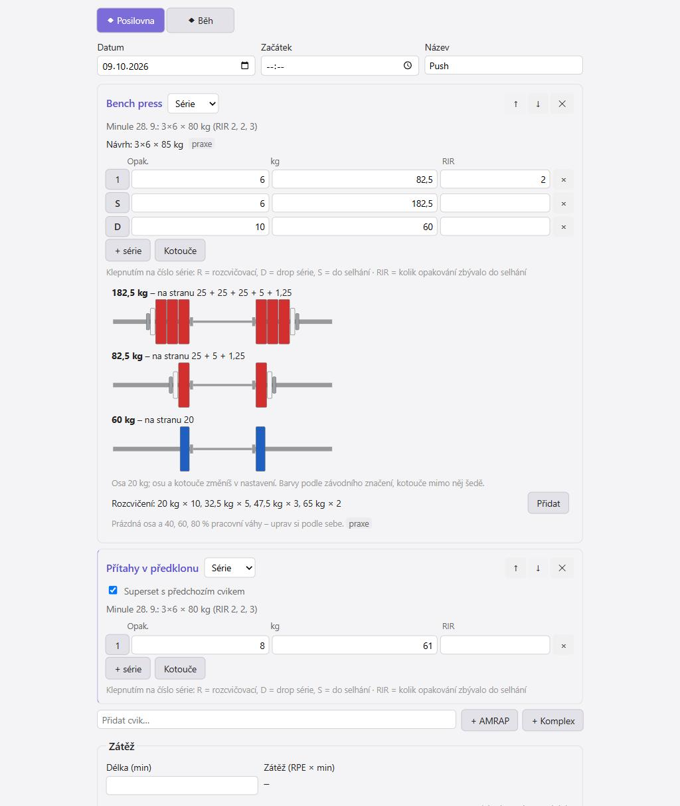

# Better Form

[English](README.md) · **Česky**

Plugin do [Obsidianu](https://obsidian.md) pro tréninkový deník: zápis tréninků, regenerace, doporučení na dnešek, plán týdne a doporučený příjem. Všechna data jsou běžné Markdown poznámky ve tvém vaultu – čitelné i bez pluginu a bez jakékoli služby třetí strany.

> **Stav:** verze 0.2.0, ve vývoji. Výpočty kryjí automatické testy; v Obsidianu je zatím vyzkoušená jen část funkcí (viz [Co není ověřené](#co-není-ověřené)). Rozhraní je anglicky a česky.

## Ukázky

Snímky se vzorovými daty ve světlém vzhledu a s českým rozhraním.

| Dnes | Plán týdne |
|---|---|
|  |  |

| Přehled | Tělo | Zápis tréninku |
|---|---|---|
|  |  |  |

## Co umí

- **Zápis tréninku** – posilovna, kalistenika, kettlebell, běh, plavání, švihadlo. Série, výdrže, EMOM, AMRAP, žebříky, komplexy; šablony a předvyplnění „z minula“ s návrhem navýšení. Rozcvičovací a drop série, série do selhání, supersety, kalkulačka kotoučů s návrhem rozcvičení.
- **Ranní check-in** do půl minuty – spánek, pocity, HRV, klidový tep, váha, kroky; nepovinně tělesné míry.
- **Dnes** – připravenost dne (0–100) s rozpadem a trendem za 14 dní, doporučení se zdůvodněním, dnešní plán a doporučená výživa.
- **Plán týdne** – tréninky naplánované dopředu, automatické odškrtnutí podle zapsaných tréninků, výhled zátěže proti posledním čtyřem týdnům. Počítá i s dny aktivních programů. Volno, nemoc a dovolená položky jen odloží a série dnů nepřeruší.
- **Programy** – vlastní i 11 předpřipravených (Základ 4, Od gauče k 5 km, První shyb, 100 kliků denně, Grease the groove, kettlebell, švihadlo…), denní počítadlo, testy maxim. Program jde vytvořit i ze souboru nebo z vloženého textu.
- **Přehledy** – zátěž, kondice a únava, tempo běhu, odhad 1RM, rekordy, odhad závodního času, graf váhy, týdenní, měsíční a roční souhrny.
- **Tělo** – panáček s týdenním objemem a regenerací svalových partií, evidence bolestí a zranění, tělesné míry.
- **Dovednosti** – žebříčky kalisteniky (shyby, kliky, dřep na jedné noze, stojka, front lever, planche…).
- **Cíle a normy** – čas na trati, síla, opakování, váha, vlastní tabulky norem; předpověď podle trendu.
- **Výživa** – doporučený denní příjem a makroživiny podle klidového výdeje, běžné aktivity, tréninků a cíle; pojistky proti příliš nízkému příjmu; kontrola podle vývoje váhy s možností doporučení jedním klepnutím posunout. Zápis jídla plugin nemá.
- **Suplementy** – evidence a dodržování, katalog 72 látek s hodnocením důkazů po oblastech přínosu, dávkováním a riziky, s filtry podle síly důkazů a bezpečnosti. Vlastní přípravek jde přidat podle etikety: fotka se přiloží a z vloženého textu složení se vyčtou látky a pohlídají horní limity, i když je stejná látka ve více suplementech.
- **Běhy z aplikací** – import ze souboru GPX, TCX nebo FIT (Strava, MapMyRun, hodinky), případně synchronizace se Stravou.
- **Denní data z hodinek** – import kroků, délky spánku, HRV, klidového tepu a váhy z CSV; doplní jen to, co v deníku chybí.
- **Přechod z jiného deníku** – import historie silových tréninků z exportu Strong a Hevy (CSV).
- **Knihovna cviků** – 268 cviků s popisem, provedením, častými chybami a zapojenými partiemi; u každého historie tvých výkonů s grafem. Vlastní cviky jdou přidat.
- **Export a záloha** – CSV pro Excel, ZIP celé složky.
- **Režim Základ** – zjednodušená obrazovka s pár cviky a během pro toho, kdo nechce nic nastavovat.

## Jak to funguje

Každý trénink, den, cvik, program nebo cíl je jedna poznámka s frontmatterem (`forma: workout`, `forma: day`, …). Plugin je čte a zapisuje jen přes API Obsidianu, nepotřebuje Dataview ani jiné pluginy a nic neposílá mimo zařízení. Výjimkou je Strava, pokud si ji sám připojíš.

Výchozí složky v češtině (v angličtině se kořen jmenuje `Better Form/` a podsložky `Journal/`, `Workouts/`, `Plan/`, `Library/` …):

```
Forma/
  Deník/        denní poznámky: spánek, check-in, HRV, váha, kroky
  Tréninky/     jedna poznámka = jeden trénink
  Plán/         jedna poznámka = plán jednoho týdne
  Knihovna/     cviky, šablony tréninků, programy, suplementy
  Cíle/  Zdraví/  Vybavení/  Testy/  Souhrny/  Export/
```

Názvy složek jdou změnit v nastavení. Jazyk složek a knihovny se volí při prvním spuštění; existující poznámky se při pozdějším přepnutí jazyka nepřejmenovávají. Tvůj text v poznámkách plugin nikdy nepřepisuje – generovaný obsah píše jen mezi značky `<!-- forma:start -->` a `<!-- forma:end -->`. Smazání z rozhraní přesouvá poznámku do koše podle nastavení Obsidianu, nikdy ji nemaže natrvalo.

## Jazyk

Rozhraní je anglicky a česky. Při prvním spuštění se jazyk vezme z Obsidianu (čeština → česky, jinak anglicky) a jde kdykoli změnit v nastavení pluginu pod „Language / Jazyk“. Přeložené je rozhraní, doporučení, generované bloky v poznámkách i knihovna cviků, programů a suplementů; co sis zapsal sám, zůstává, jak jsi to napsal. Vestavěné cviky mají název v druhém jazyce jako alias, takže odkazy a historie fungují v obou jazycích. Názvy příkazů v paletě se změní až po restartu Obsidianu.

## Instalace

Plugin zatím není v katalogu komunitních pluginů, instaluje se ručně. Potřebuješ Obsidian 1.6.0 nebo novější.

**Ručně (počítač i telefon):**

1. Stáhni z [posledního vydání](https://github.com/ssestorad/Better-Form/releases/latest) soubory `main.js`, `manifest.json` a `styles.css` (nebo plugin sestav sám, viz [Vývoj](#vývoj)).
2. Zkopíruj je do složky `<vault>/.obsidian/plugins/better-form/`.
3. V Obsidianu otevři Nastavení → Komunitní pluginy, povol komunitní pluginy a zapni **Better Form**.

**Přes plugin BRAT (aktualizace se stahují samy):** nainstaluj z katalogu plugin *BRAT*, v jeho nastavení zvol „Add beta plugin“ a zadej `ssestorad/Better-Form`.

## První kroky

1. Po prvním zapnutí se otevře **průvodce nastavením** (pohlaví, rok narození, výška, hmotnost, cíl, sporty). Plugin založí složky, knihovnu cviků a předpřipravené programy. Průvodce jde kdykoli spustit znovu příkazem „Průvodce nastavením“.
2. Otevři panel ikonou činky v levé liště nebo příkazem „Otevřít přehled“.
3. Ráno vyplň **check-in**, po tréninku **Zapsat trénink**. U tréninku zadej RPE (pocit náročnosti 0–10) a délku – z nich se počítá zátěž, připravenost i doporučení.
4. Přehledy a doporučení se plní postupně. Kde zatím není z čeho počítat, uvidíš „sbírám data (X z Y dní)“ místo prázdného grafu.

Po aktualizaci pluginu doplníš nové cviky, programy a šablony tréninků (push a pull pro posilovnu i vlastní váhu) příkazem „Doplnit knihovnu cviků, programy a šablony“; existující poznámky se nemění.

## Karty

| Karta | K čemu je |
|---|---|
| Dnes | check-in, připravenost, doporučení, dnešní plán, dnešní tréninky, výživa na dnešek |
| Zapsat | nový trénink, šablony, běhy k doplnění |
| Plán | týden po dnech, souhrn a výhled zátěže |
| Přehled | souhrny, grafy, rekordy, série a odznaky |
| Tělo | objem a regenerace partií, bolesti |
| Dovednosti | žebříčky kalisteniky |
| Programy | aktivní programy, knihovna programů, testy maxim |
| Cíle | cíle a normy |
| Výživa | doporučený příjem s rozpadem výpočtu, kontrola podle váhy |
| Suplementy | co beru, dodržování, katalog |
| Nastavení | průvodce nastavením (profil, cíl, režim, sporty) a odkaz na všechna nastavení pluginu |

Všechny hlavní akce jsou i v paletě příkazů (Ctrl+P), například „Zapsat trénink“, „Ranní check-in“, „Plán týdne“, „Naplánovat trénink“, „Test maxima“, „Importovat běh ze souboru (GPX, TCX, FIT)“, „Exportovat tréninky a denní data do CSV“, „Zálohovat složku do ZIP“.

## Běhy z aplikací

### Ze souboru (bez předplatného)

Tlačítko **Ze souboru** na kartě Dnes nebo Zapsat, případně v nastavení. Jde vybrat víc souborů najednou.

- **Strava:** na webu strava.com otevři svou aktivitu → tři tečky (Více) → Export GPX. Funguje i z bezplatného účtu; v mobilní aplikaci export není.
- **MapMyRun:** na webu mapmyrun.com otevři trénink → tři tečky → Download as TCX.
- **Hodinky a jiné aplikace:** většina umí export do GPX, TCX nebo FIT.

Načte se datum a čas, vzdálenost, čas v pohybu, tep (pokud v souboru je), převýšení a nejrychlejší úseky od 1 km po maraton. Běh se objeví v seznamu „k doplnění“, kde přidáš RPE, typ běhu a boty. Tentýž soubor podruhé se přeskočí; ručně zapsaný běh ze stejného dne se stejnou vzdáleností se jen doplní o měřené údaje. Vzdálenost a převýšení se počítají z poloh GPS, takže se od čísel v aplikaci můžou o pár procent lišit. Soubor FIT z hodinek obsahuje i tep.

### Synchronizace se Stravou

Od června 2026 Strava dovoluje založit API aplikaci jen účtům s **placeným předplatným**. Pokud ho máš, v nastavení pluginu je návod krok za krokem: založíš si vlastní API aplikaci, vložíš Client ID a Client Secret a připojíš účet. Synchronizace se spouští jen ručně. Přihlašovací údaje zůstávají v souboru `data.json` pluginu ve tvém vaultu.

## Síť a soukromí

- Plugin pracuje **offline** a všechna data ukládá jako poznámky v tvém vaultu. Nic neodesílá, nemá telemetrii ani reklamy a nepotřebuje žádný účet.
- **Jediné síťové spojení je volitelná synchronizace se Stravou** (`www.strava.com`): přihlášení přes OAuth a stažení tvých aktivit. Spouští se jen ručně, a jen když si ji v nastavení zapneš a vložíš vlastní údaje API aplikace. Na počítači plugin během přihlášení krátce spustí místní server na `127.0.0.1`, aby přijal odpověď Stravy; na telefonu se používá ruční vložení kódu.
- Mimo vault plugin nic nečte ani nezapisuje – importované soubory si vybíráš sám a export i záloha ZIP se ukládají do vaultu.

## Odkud doporučení jsou

Každé doporučení a každý výpočet má uvedený zdroj a štítek úrovně důkazu:

- **výzkum** – opírá se o studie nebo metaanalýzy,
- **konsenzus** – stanoviska odborných společností,
- **praxe** – zavedená trenérská heuristika bez vlastní studie.

Heuristika se nikdy nevydává za výzkum. Katalog obsahuje přes 350 ověřených zdrojů; jejich seznam je v [SPEC.md](SPEC.md), kapitola 14.

## Upozornění

- **Není to zdravotnická aplikace.** Plugin nic nediagnostikuje. U bolesti od 4/10 nebo trvající déle než 7 dní doporučí odborníka – ber to vážně.
- **Výživa je odhad.** Doporučený příjem vychází z rovnic s přesností zhruba ±10 % a nikdy neklesne pod klidový výdej. Jestli sedí, ukáže až vývoj váhy za 2–3 týdny.
- **Doporučení jsou orientační** a nenahrazují trenéra, fyzioterapeuta ani lékaře.

### Co není ověřené

- V Obsidianu na počítači je ověřený zápis tréninku (i ze šablon), panáček, check-in a denní poznámka, plán týdne se souhrnem, karta Suplementy, Přehled, mazání a import GPX ze Stravy. Karta Výživa, měsíční a roční souhrn a provoz na telefonu zatím prošly jen testy a náhledem.
- Anglické rozhraní prošlo testy a náhledem, v Obsidianu zatím ne.
- Synchronizace se Stravou nebyla vyzkoušená proti skutečnému API.
- Import TCX z MapMyRun, import FIT, načtení tepu ze souboru, import denních dat z CSV a import historie ze Strong a Hevy jsou vyzkoušené jen na ručně sestavených souborech. Import historie si nejdřív vyzkoušej na záloze.
- Na mobilu plugin zatím vyzkoušený nebyl.

Otevřené body a plány jsou v [SPEC.md](SPEC.md), kapitola 13.

## Vývoj

Zadání je v [SPEC.md](SPEC.md), pravidla vývoje v [CLAUDE.md](CLAUDE.md) (obojí česky). Potřebuješ Node.js a npm (automatická kontrola běží na Node 24).

```powershell
npm install
npm run dev        # sestavuje při každé změně; s VAULT_PATH v .env.local rovnou kopíruje do vaultu
npm run build      # typová kontrola + produkční build
npm test           # testy (Vitest)
npm run deploy     # build + kopie main.js, manifest.json, styles.css do <vault>/.obsidian/plugins/better-form/
```

Pro nasazení zkopíruj `.env.local.example` na `.env.local` a vyplň `VAULT_PATH`. Soubor `.env.local` se necommituje.

| Složka | Obsah |
|---|---|
| `src/calc/`, `src/rules/` | výpočty a pravidla doporučení – čisté funkce bez závislosti na Obsidianu, každý vzorec má test |
| `src/data/` | čtení a zápis poznámek |
| `src/model/` | datový model poznámek (frontmatter) |
| `src/evidence/` | katalog zdrojů |
| `src/i18n/` | překlad: `t()` / `tn()`, anglický slovník `en.ts` (klíč = český text) |
| `src/seed/` | knihovna cviků, programy, katalog suplementů; anglické verze v `src/seed/en/` |
| `src/ui/` | rozhraní (Svelte 5) |
| `tests/` | testy včetně datové vrstvy nad vaultem v paměti |

Při každém pushi do `main` spustí GitHub Actions testy, typovou kontrolu a build.

**Vydání:** zvyš verzi ve `manifest.json` a `package.json`, do `versions.json` přidej `"<verze>": "<minAppVersion>"`, commitni a pushni tag se stejným číslem bez `v` (např. `git tag 0.2.1` a `git push origin 0.2.1`). Workflow „Vydání“ zkontroluje, že tag sedí se všemi třemi soubory, spustí testy a build a založí release se soubory `main.js`, `manifest.json` a `styles.css`.

## Licence

MIT – viz [LICENSE](LICENSE).
