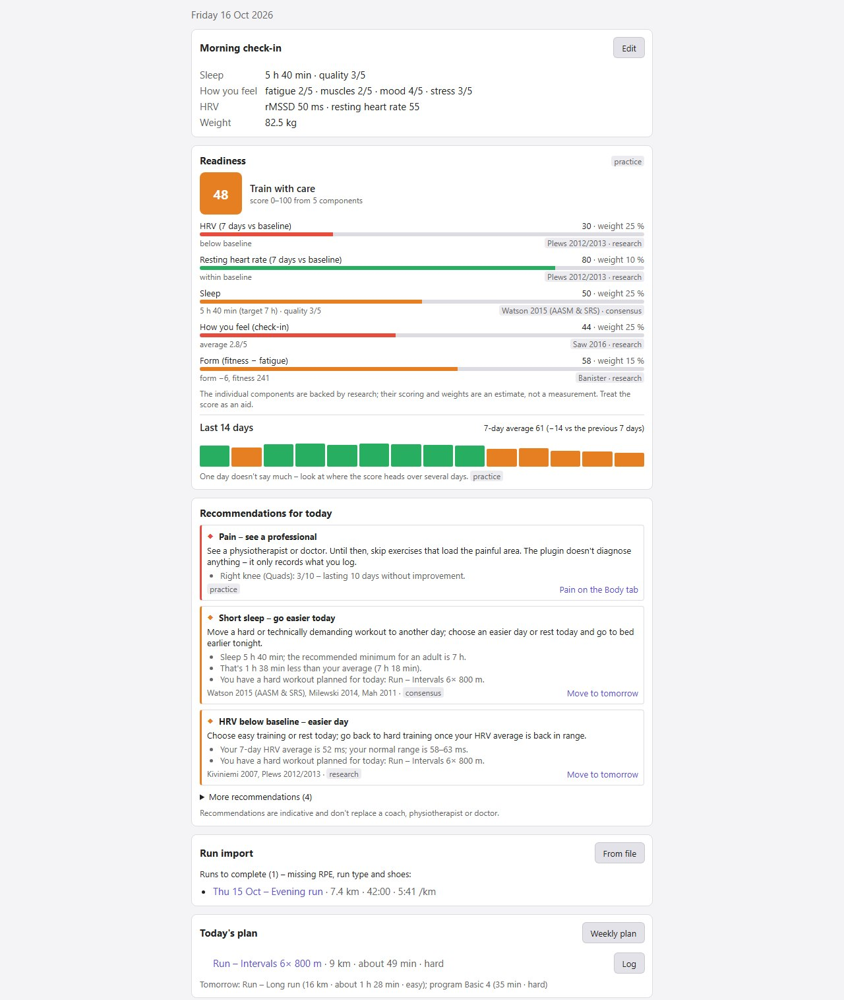
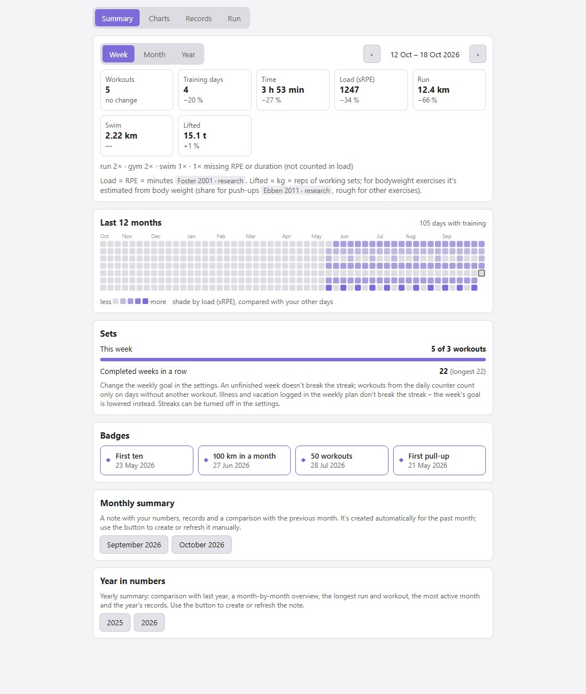
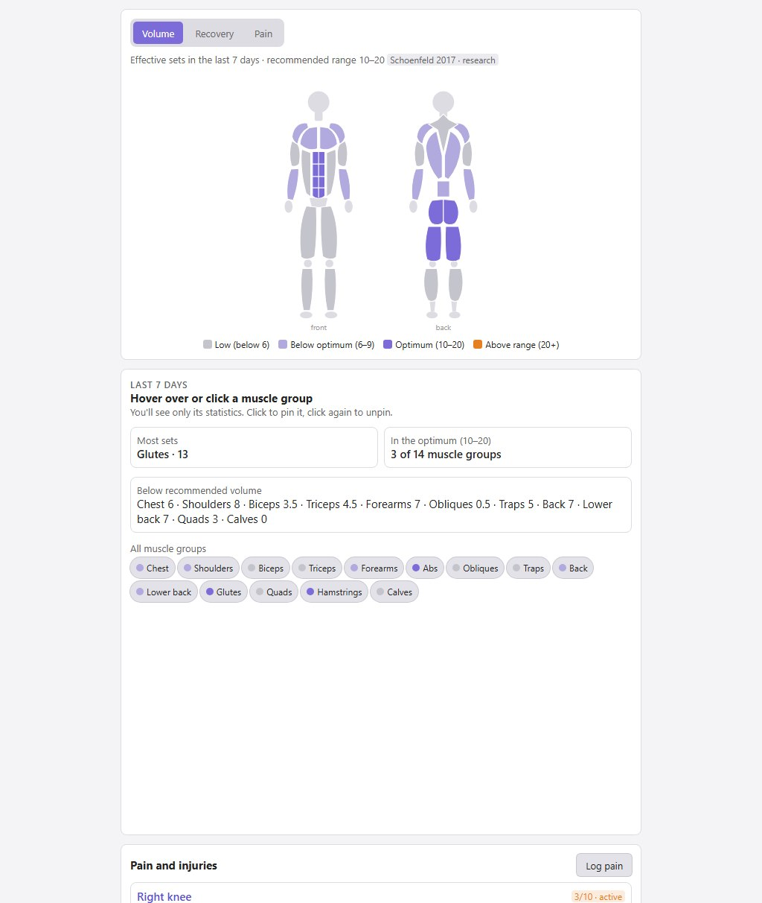
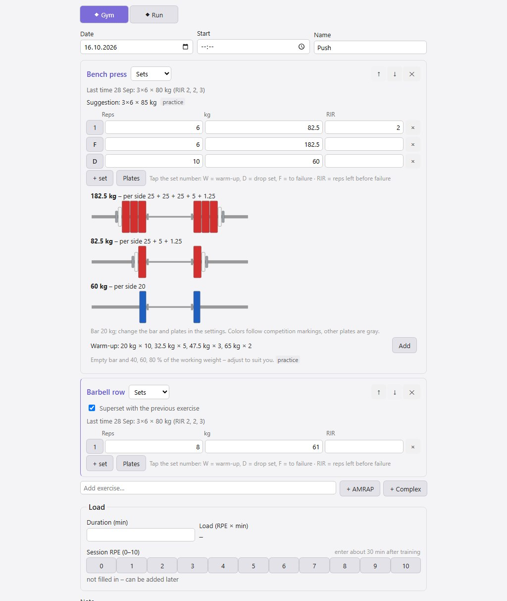

# Better Form

**English** · [Česky](README.cs.md)

A training log plugin for [Obsidian](https://obsidian.md): workout logging, recovery, recommendations for today, a weekly plan and a suggested daily intake. All data are plain Markdown notes in your vault – readable without the plugin and without any third-party service.

> **Status:** version 0.3.0, in development. Calculations are covered by automated tests; only part of the features has been tried in Obsidian so far (see [Not yet verified](#not-yet-verified)). The interface is in English and Czech.

## Screenshots

Sample data, light theme. The interface is also available in Czech (screenshots in [README.cs.md](README.cs.md)).

| Today | Weekly plan |
|---|---|
|  |  |

| Overview | Body | Logging a workout |
|---|---|---|
|  |  |  |

## Features

- **Workout logging** – gym, calisthenics, kettlebell, running, swimming, jump rope. Sets, holds, EMOM, AMRAP, ladders, complexes; templates and "same as last time" prefill with a suggested progression. Warm-up and drop sets, sets to failure, supersets, a plate calculator with a suggested warm-up.
- **Morning check-in** in under half a minute – sleep, how you feel, HRV, resting heart rate, weight, steps; optionally body measurements.
- **Today** – daily readiness (0–100) with a breakdown and a 14-day trend, recommendations with reasons, today's plan and suggested nutrition.
- **Weekly plan** – workouts planned ahead, automatically ticked off from logged workouts, a load outlook against the last four weeks. Days of active programs count too. Rest days, illness and vacation only postpone items and don't break streaks.
- **Programs** – your own and 11 built-in ones (Basic 4, Couch to 5K, Zero to your first pull-up, 100 push-ups a day, Grease the groove, kettlebell, jump rope…), a daily counter, max tests. A program can also be created from a file or from pasted text.
- **Reports** – training load, fitness and fatigue, running pace, estimated 1RM, records, race time prediction, weight chart, weekly, monthly and yearly summaries.
- **Body** – a body figure with weekly volume and recovery per muscle group, a log of pain and injuries, body measurements.
- **Skills** – calisthenics progressions (pull-ups, push-ups, pistol squat, handstand, front lever, planche…).
- **Goals and standards** – time over a distance, strength, reps, weight, your own standards tables; a forecast from the trend.
- **Nutrition** – suggested daily intake and macros from resting energy expenditure, everyday activity, workouts and your goal; safeguards against too low an intake; a check against your weight trend with a one-tap adjustment. There is no food logging.
- **Supplements** – tracking and adherence, a catalog of 72 substances with evidence ratings per benefit area, dosing and risks, filters by strength of evidence and safety. You can add your own product from its label: attach a photo, paste the ingredient list, and the plugin picks out the substances and checks upper limits even when the same substance is in several supplements.
- **Runs from apps** – import from GPX, TCX or FIT files (Strava, MapMyRun, watches), or Strava sync.
- **Daily data from your watch** – import steps, sleep duration, HRV, resting heart rate and weight from CSV; only fills in what's missing in the journal.
- **Switching from another log** – import strength workout history from Strong and Hevy exports (CSV).
- **Exercise library** – 268 exercises with a description, technique, common mistakes and muscles worked; each has a history of your results with a chart. You can add your own exercises.
- **Export and backup** – CSV for spreadsheets, ZIP of the whole folder.
- **Basic mode** – a simplified screen with a few exercises and running for anyone who doesn't want to set anything up.

## How it works

Every workout, day, exercise, program or goal is one note with frontmatter (`forma: workout`, `forma: day`, …). The plugin reads and writes them only through the Obsidian API, needs no Dataview or other plugins and sends nothing off your device – the only exception is Strava, if you connect it yourself.

Default folders (always in English; vaults created by version 0.2 or older keep their Czech `Forma/` folders):

```
Better Form/
  Journal/      daily notes: sleep, check-in, HRV, weight, steps
  Workouts/     one note = one workout
  Plan/         one note = the plan for one week
  Library/      exercises, workout templates, programs, supplements
  Goals/  Health/  Equipment/  Tests/  Summaries/  Export/
```

Folder names can be changed in the settings. Existing notes are never renamed when you switch languages; the "Translate notes" button next to the language setting translates the built-in library (exercises, templates, programs) and the texts the plugin generated in your notes – texts you edited stay as they are. The plugin never rewrites your own text in notes – generated content goes only between the `<!-- forma:start -->` and `<!-- forma:end -->` markers. Deleting from the interface moves the note to the trash according to Obsidian's settings, never deletes it permanently.

## Language

The interface is in English and Czech. On first run the language follows Obsidian's (a supported language, otherwise English); change it any time in the plugin settings under "Language". The interface, recommendations, generated blocks in notes and the exercise, program and supplement library are all translated; whatever you wrote yourself stays as you wrote it. Your data – folders and library note names in a new vault – is always in English, whatever the interface language. Built-in exercises have their names in all languages as aliases, so links and history work in any combination of languages. Command names in the command palette change after restarting Obsidian.

## Installation

The plugin isn't in the community plugin directory yet, so it's installed manually. You need Obsidian 1.8.7 or newer.

**Manually (desktop and mobile):**

1. Download `main.js`, `manifest.json` and `styles.css` from the [latest release](https://github.com/ssestorad/Better-Form/releases/latest) (or build the plugin yourself, see [Development](#development)).
2. Copy them into `<vault>/.obsidian/plugins/better-form/`.
3. In Obsidian open Settings → Community plugins, enable community plugins and turn on **Better Form**.

**With the BRAT plugin (updates are downloaded automatically):** install *BRAT* from the directory, choose "Add beta plugin" in its settings and enter `ssestorad/Better-Form`.

## Getting started

1. On first launch a **setup guide** opens (sex, birth year, height, weight, goal, sports). The plugin creates the folders, the exercise library and the built-in programs. Run the guide again any time with the "Setup guide" command.
2. Open the panel with the dumbbell icon in the left ribbon or with the "Open overview" command.
3. Fill in the **check-in** in the morning and **Log workout** after training. Enter RPE (perceived effort 0–10) and duration for each workout – training load, readiness and recommendations are calculated from them.
4. Reports and recommendations fill up gradually. Where there isn't enough data yet, you'll see "collecting data (X of Y days)" instead of an empty chart.

After updating the plugin, add new exercises, programs and workout templates (push and pull for the gym and for bodyweight) with the "Add missing exercises, programs and templates to the library" command; existing notes are left unchanged.

## Tabs

| Tab | What it's for |
|---|---|
| Today | check-in, readiness, recommendations, today's plan, today's workouts, today's nutrition |
| Log | new workout, templates, runs to complete |
| Plan | the week day by day, summary and load outlook |
| Overview | summaries, charts, records, streaks and badges |
| Body | volume and recovery per muscle group, pain |
| Skills | calisthenics progressions |
| Programs | active programs, program library, max tests |
| Goals | goals and standards |
| Nutrition | suggested intake with the calculation breakdown, check against weight |
| Supplements | what I take, adherence, catalog |
| Settings | setup guide (profile, goal, mode, sports) and a link to all plugin settings |

All main actions are in the command palette too (Ctrl+P), for example "Log workout", "Morning check-in", "Weekly plan", "Plan a workout", "Max test", "Import run from file (GPX, TCX, FIT)", "Export workouts and daily data to CSV", "Back up folder to ZIP".

## Runs from apps

### From a file (no subscription needed)

The **From file** button on the Today or Log tab, or in the settings. You can pick several files at once.

- **Strava:** on strava.com open your activity → the three dots (More) → Export GPX. Works with a free account; the mobile app has no export.
- **MapMyRun:** on mapmyrun.com open the workout → the three dots → Download as TCX.
- **Watches and other apps:** most can export GPX, TCX or FIT.

The date and time, distance, moving time, heart rate (if the file has it), elevation gain and fastest splits from 1 km to the marathon are read. The run appears in the "runs to complete" list, where you add RPE, run type and shoes. The same file a second time is skipped; a manually logged run on the same day with the same distance just gets the measured data added. Distance and elevation are calculated from GPS positions, so they can differ from the app's numbers by a few percent. FIT files from watches include heart rate.

### Strava sync

Since June 2026 Strava only lets accounts with a **paid subscription** create an API application. If you have one, the plugin settings walk you through it step by step: create your own API application, paste the Client ID and Client Secret and connect your account. Sync only runs when you start it. Credentials stay in the plugin's `data.json` file in your vault.

## Adding a language

English is the source language: interface texts and the built-in library are written in English in the code, and every other language is a translation in its own folder. To add one:

1. Copy `src/locales/cs/` to `src/locales/<code>/` (for example `de`) and set `code` and `label` in its `index.ts`.
2. Translate the values (never the keys): `ui.ts` for the interface, `exercises.ts`, `programs.ts`, `research.ts`, `supplements.ts`, `amino.ts` and `sources.ts` for the library. Plural forms follow `Intl.PluralRules` for the language (`one`, `few`, `many`, `other`).
3. Register the language with one line in `src/locales/index.ts`.
4. Run `npm test` – the tests list every missing or mismatched translation for each registered language. `I18N_DUMP=missing-{code}.json npm test` writes the missing interface texts to a file.

The language then appears in the settings and is picked automatically when Obsidian uses it.

## Network and privacy

- The plugin works **offline** and stores all data as notes in your vault. It sends nothing, has no telemetry or ads and needs no account.
- **The only network connection is the optional Strava sync** (`www.strava.com`): OAuth sign-in and downloading your activities. It only runs when you start it, and only after you enable it in the settings and enter your own API application details. On desktop the plugin briefly starts a local server on `127.0.0.1` during sign-in to receive Strava's response; on mobile you paste the code manually.
- The plugin reads and writes nothing outside the vault – you pick imported files yourself, and exports and ZIP backups are saved into the vault.

## Where recommendations come from

Every recommendation and every calculation shows its source and an evidence label:

- **research** – based on studies or meta-analyses,
- **consensus** – position stands of professional bodies,
- **practice** – an established coaching heuristic without its own study.

A heuristic is never presented as research. The catalog contains over 350 verified sources; they are listed in [SPEC.md](SPEC.md), chapter 14 (in Czech).

## Disclaimer

- **This is not a medical app.** The plugin diagnoses nothing. For pain of 4/10 or more, or lasting longer than 7 days, it recommends seeing a professional – take that seriously.
- **Nutrition is an estimate.** The suggested intake comes from equations accurate to roughly ±10 % and never drops below resting energy expenditure. Only your weight trend over 2–3 weeks shows whether it fits.
- **Recommendations are guidance** and don't replace a coach, physiotherapist or doctor.

### Not yet verified

- Verified in Obsidian on desktop: workout logging (including from templates), the body figure, check-in and the daily note, the weekly plan with its summary, the Supplements tab, Overview, deleting, and GPX import from Strava. The Nutrition tab, monthly and yearly summaries and use on mobile have only been through tests and a preview.
- The English interface and translating an existing Czech vault with "Translate notes" have been tried in Obsidian.
- Strava sync hasn't been tried against the real API.
- TCX import from MapMyRun, FIT import, reading heart rate from a file, daily data import from CSV and history import from Strong and Hevy have only been tried on hand-built files. Try the history import on a backup first.
- The plugin hasn't been tried on mobile yet.

Open items and plans are in [SPEC.md](SPEC.md), chapter 13.

## Development

The specification is in [SPEC.md](SPEC.md) and the development rules in [CLAUDE.md](CLAUDE.md) (both in Czech). You need Node.js and npm (CI runs on Node 24).

```powershell
npm install
npm run dev        # rebuilds on every change; with VAULT_PATH in .env.local it copies straight into the vault
npm run build      # type check + production build
npm test           # tests (Vitest)
npm run deploy     # build + copy main.js, manifest.json, styles.css to <vault>/.obsidian/plugins/better-form/
```

To deploy, copy `.env.local.example` to `.env.local` and fill in `VAULT_PATH`. `.env.local` is never committed.

| Folder | Contents |
|---|---|
| `src/calc/`, `src/rules/` | calculations and recommendation rules – pure functions without Obsidian dependencies, every formula has a test |
| `src/data/` | reading and writing notes |
| `src/model/` | note data model (frontmatter) |
| `src/evidence/` | source catalog |
| `src/i18n/` | translation: `t()` / `tn()` with plural forms and context, language selection |
| `src/locales/` | one folder per language (key = English text or built-in content id) and the language registry |
| `src/seed/` | exercise library, programs, templates, supplement catalog, research – English source with stable ids |
| `src/ui/` | interface (Svelte 5) |
| `tests/` | tests, including the data layer over an in-memory vault |

Every push to `main` runs tests, the type check and the build on GitHub Actions.

**Releasing:** bump the version in `manifest.json` and `package.json`, add `"<version>": "<minAppVersion>"` to `versions.json`, commit, and push a tag with the same number without a `v` (e.g. `git tag 0.2.2` and `git push public 0.2.2`). The "Vydání" (release) workflow checks that the tag matches all three files, runs the tests and build and creates a release with `main.js`, `manifest.json` and `styles.css`.

## License

MIT – see [LICENSE](LICENSE).
