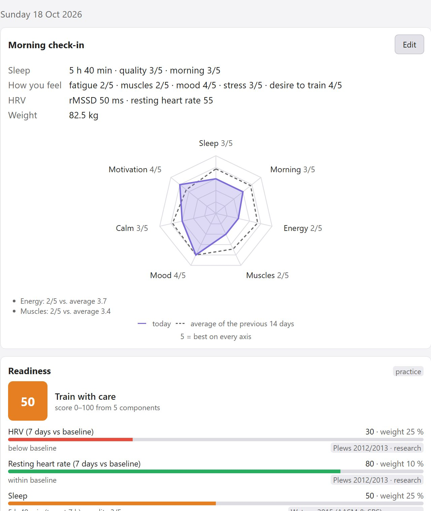
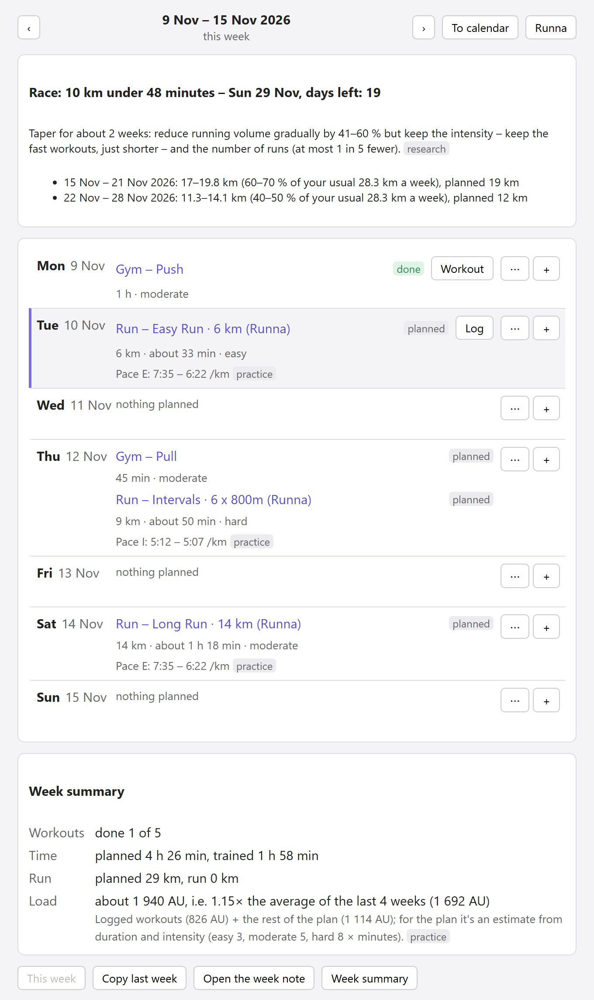
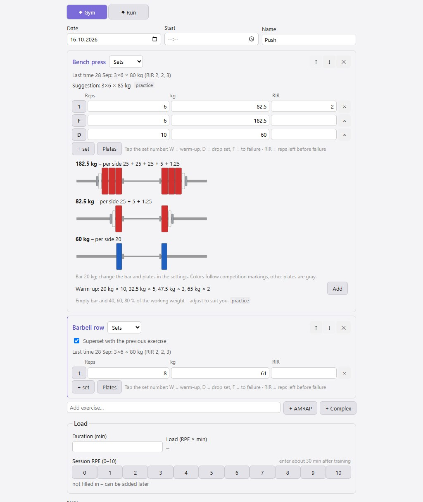
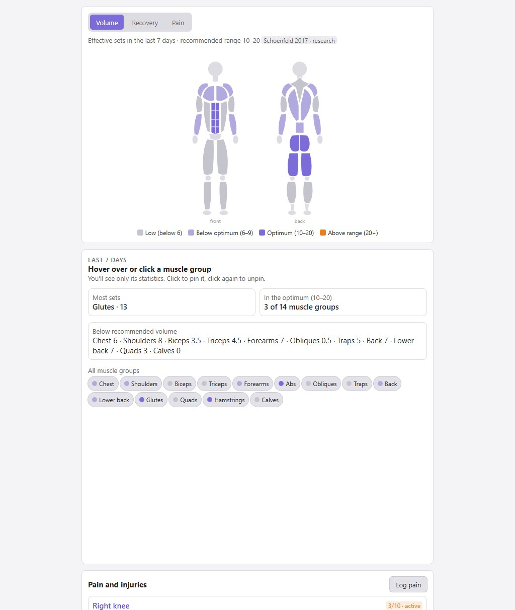
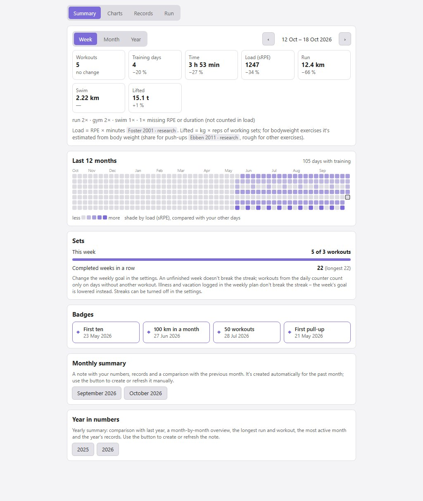
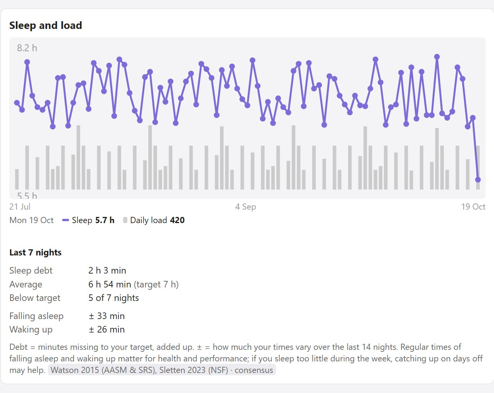
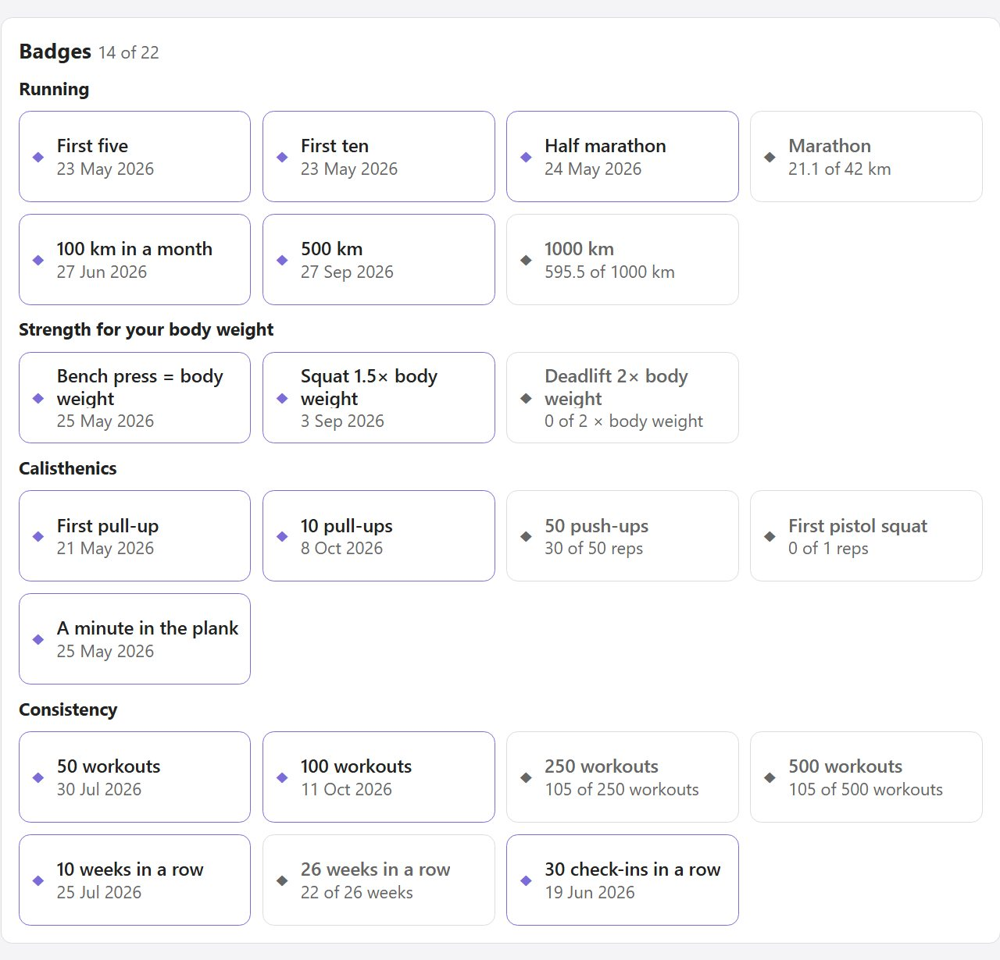
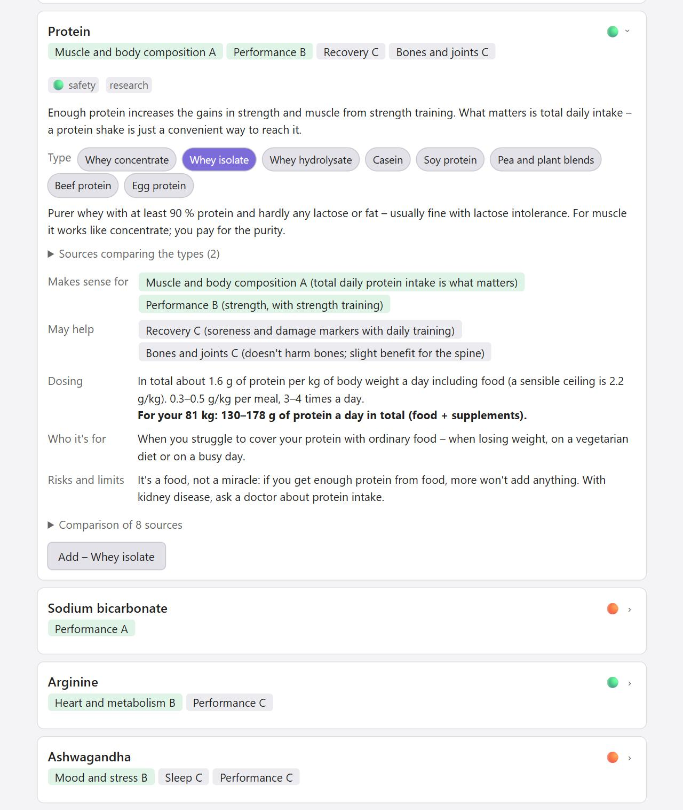
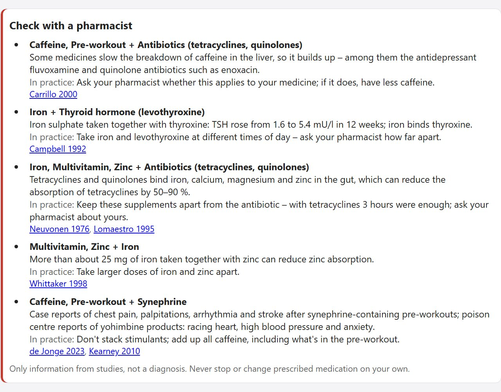
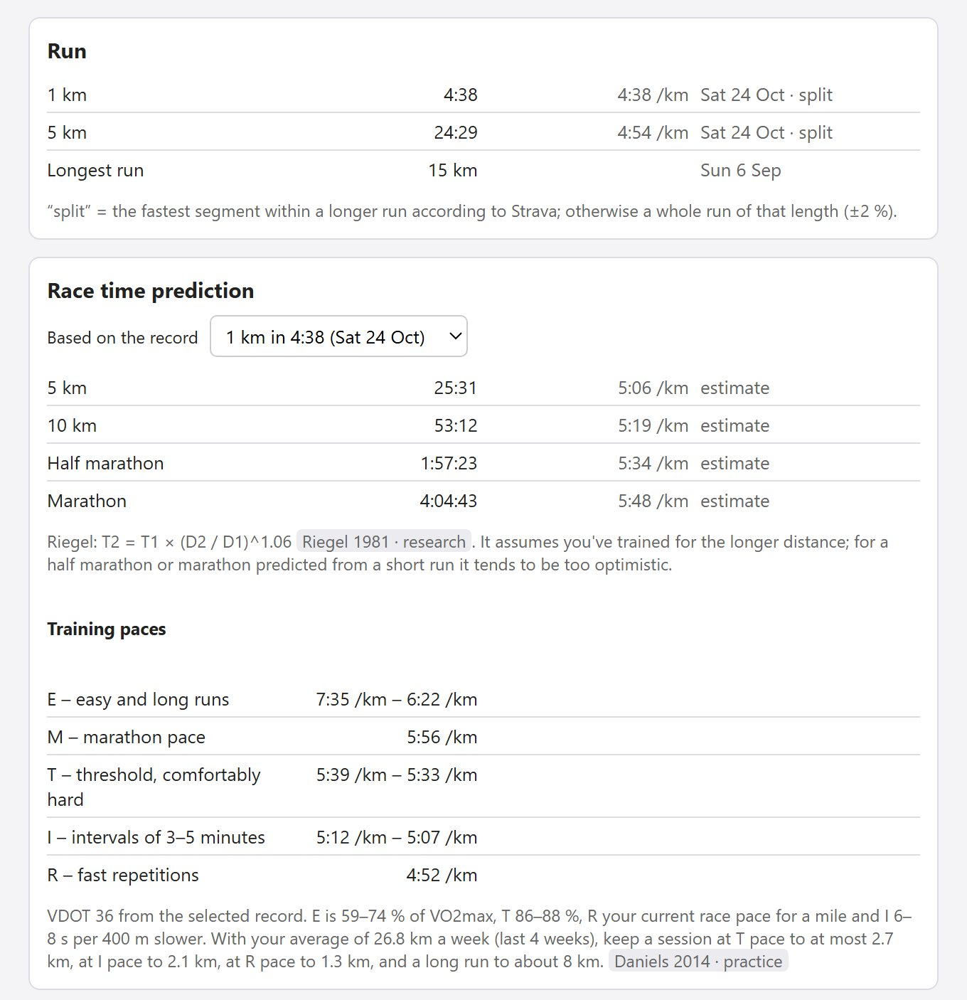

# Better Form

**English** · [Česky](README.cs.md)

**A training log for [Obsidian](https://obsidian.md) that shows where its advice comes from.** Log a workout in a minute and a morning check-in in half a minute. The plugin turns them into readiness for the day, recommendations, a weekly plan and a suggested daily intake – and every number comes with its source.

- **Your data stays yours.** Every workout and every day is a plain Markdown note in your vault, readable without the plugin. Offline, no account, no telemetry, no ads.
- **Advice you can check.** Every recommendation and calculation shows its source and whether it rests on research, consensus or coaching practice – 953 verified sources, including 30 coaching and sports nutrition books.
- **Training, recovery and nutrition in one place.** Gym, calisthenics, kettlebell, running, swimming and jump rope; readiness from sleep, HRV and training load; a suggested intake that never drops below your resting energy expenditure.

> **Status:** version 0.5.0, in the community plugin directory, in development. It runs on desktop and mobile. Calculations are covered by automated tests, but only part of the features has been tried in Obsidian so far, and on a phone only a few – see [Testing status](#testing-status). The interface is in English and Czech.

## Screenshots

Sample data, light theme. Czech screenshots are in [README.cs.md](README.cs.md).

| Today | Weekly plan |
|---|---|
|  |  |

| Logging a workout | Body |
|---|---|
|  |  |

| Overview | A week of sleep |
|---|---|
|  |  |

| Badges | Supplement catalog |
|---|---|
|  |  |

| Supplement safety | Training paces |
|---|---|
|  |  |

## Getting started

You need Obsidian 1.13 or newer (older versions keep Better Form 0.3.2).

1. **Install:** Settings → Community plugins → **Browse**, search for **Better Form**, **Install** and **Enable**. Updates come through Settings → Community plugins → Check for updates. (The directory notes that the plugin passed the automated checks but wasn't reviewed manually by Obsidian staff.)
2. **Set up:** a short guide opens on first launch – sex, birth year, height, weight, goal and sports. The plugin creates its folders, the exercise library and the built-in programs. Run it again any time with the "Setup guide" command.
3. **Open the panel** with the dumbbell icon in the left ribbon or the "Open overview" command.
4. **Every day:** fill in the **check-in** in the morning and **Log workout** after training, with RPE (perceived effort 0–10) and duration – load, readiness and recommendations are calculated from them.

Reports fill up gradually; until there's enough data you'll see "collecting data (X of Y days)" instead of an empty chart. After an update, the "Add missing exercises, programs and templates to the library" command adds new built-in content and leaves your notes unchanged.

**Manual install:** download `main.js`, `manifest.json` and `styles.css` from the [latest release](https://github.com/ssestorad/Better-Form/releases/latest) (or build them, see [Development](#development)), copy them to `<vault>/.obsidian/plugins/better-form/` and turn on **Better Form** in Settings → Community plugins.

### On your phone

The plugin works on Obsidian for Android and iOS; on a phone the panel usually opens in the side drawer.

- **Tap instead of hover:** where the desktop shows extra information when you hover over something (a record's date, a table row's details), tap it on the phone – the text appears as a notice.
- **Strava** signs in by pasting a code instead of the local server the desktop uses; the settings walk you through it. Garmin Connect, Runna and imports from a file work the same as on desktop.
- **Quick links:** Settings → Better Form → Quick links for your phone has ready-made `obsidian://better-form?…` links (check-in, log a workout or a template, add to a daily counter, sync) for a home-screen shortcut or iOS Shortcuts. Commands can also go into the mobile toolbar (Obsidian settings → Toolbar).
- **If a tab can't be displayed,** you'll see a box with the error text instead of an empty tab – send it to the author ([an issue on GitHub](https://github.com/ssestorad/Better-Form/issues)), it says exactly what failed.

## What's on each tab

The panel has one tab per area. Parts you don't use can be turned off in Settings → Modules (also in the setup guide) – a whole tab like Supplements or Nutrition, or a smaller part like the body figure or the Runna button. Nothing is deleted. The pain log can't be turned off. The **Exercise library** button next to every tab's title opens the library from anywhere, every setting can be found through Obsidian's settings search, and the main actions are in the command palette (Ctrl+P) too.

### Today

- **Morning check-in** in under half a minute – sleep, how you feel, desire to train, HRV, resting heart rate, weight, steps, optionally body measurements. A radar chart compares today with the last 14 days.
- **Readiness** (0–100) with a breakdown and a 14-day trend.
- **Recommendations** with their reasons and sources – sleep, HRV, load jumps, muscle recovery, pain, deload, goals, the weekly plan, nutrition. For example, a planned run more than 10 % longer than your longest run of the last 30 days gets a warning.
- **Habit journal** – tick yesterday's habits (alcohol, caffeine after 2 pm, late meal, screen before bed, travel – the list is editable). Once there are at least 5 days with and 5 without a habit in the last 90 days, the card shows how your next morning differed (HRV, resting heart rate, sleep, how you feel) – an association, not a cause.
- **Sleep debt** over the last 7 nights (once at least 4 nights are logged), today's plan, today's workouts and today's nutrition.

### Log

- **Workouts** – gym, calisthenics, kettlebell, running, swimming, jump rope. Sets, holds, EMOM, AMRAP, ladders, complexes, supersets; warm-up, drop sets and sets to failure; templates (including stretching after a run, after strength training and a mobility routine) and "same as last time" with a suggested progression; a plate calculator with a suggested warm-up.
- **Runs to complete** – runs imported from a file, Garmin Connect or Strava, waiting for RPE, run type and shoes.
- **Exercise library** – 268 exercises with technique, common mistakes, muscles worked, the equipment they need (with a filter) and **substitutes** for the same muscles when a machine is taken. Every exercise has a history of your results with a chart; you can add your own.

### Plan

- **The week day by day** – workouts planned ahead and ticked off automatically from what you log, including days of active programs; for programs that alternate workouts the plan shows which one is due (workout A, B or C).
- **Plan from Runna** – your Runna training plan for the next 4 weeks, loaded from its calendar link (it works with other coaching apps that offer an iCal link too).
- **Target pace** for planned runs by Jack Daniels from your latest record – easy, threshold, interval or repetition pace by the workout's name and intensity.
- **Race taper** – when a race time goal has a date within 3 weeks, the plan shows how to taper for the last 2 weeks: running volume gradually down by 41–60 % with the intensity and number of runs kept, and how much you have planned.
- **Load outlook** against the last four weeks, and a warning for a planned run that's much longer than usual.
- **Run adjustments** – for today's and tomorrow's run the plan suggests a change with the reason: skip it with leg pain of 4/10 or more, run easy and shorter with milder pain, take it easy on a low-readiness day, and don't make up missed runs. Only a suggestion; the plan stays as it is.
- **Rest, illness and vacation** only postpone items and don't break streaks.
- **To calendar** saves the week as an `.ics` file for Google, Outlook or Apple Calendar; importing it again updates the events instead of duplicating them. Workouts loaded from Runna are left out – they're already in your calendar.
- **To watch** saves the week's upcoming runs as `.fit` workouts with the target pace – copy them to a Garmin over USB (`GARMIN/NewFiles`) or import them in the watch maker's app. Each run is one step; intervals aren't split up.

### Overview

- **Summary** – week, month and year in numbers, a 12-month workout calendar, streaks (completed weeks in a row) and 22 badges for running, strength for your body weight, calisthenics and consistency; monthly and yearly summary notes.
- **Charts** – load, fitness and fatigue; running pace and cadence; estimated 1RM; sleep and load with the last 7 nights (sleep debt and how regular your sleep times are – set the target under Advanced → HRV and sleep); weight with the trend weight; HRV.
- **Records**, a race time prediction and **training paces** by Jack Daniels (easy, marathon, threshold, interval and repetition pace from the selected record) with limits on fast running based on your weekly volume.
- **Running** – heart-rate zones, the 80/20 intensity split, shoes and their mileage.

### Body

- A **body figure** with weekly volume and recovery per muscle group – highlighting never changes the layout.
- **Pain and injuries** log with their history; for pain of 4/10 or more or lasting over 7 days the plugin recommends a professional.
- **Body measurements**.

### Skills, Programs and Goals

- **Skills** – calisthenics progressions: pull-ups, push-ups, pistol squat, handstand, front lever, planche…
- **Programs** – your own and 14 built-in ones (Basic 4, Couch to 5K, Zero to your first pull-up, 100 push-ups a day, Grease the groove, Novice strength 3×5, Kettlebell – Program Minimum and Simple & Sinister, jump rope…), a daily counter and max tests. Workouts can alternate in order – A/B or A/B/C – whatever the day of the week. A program can also be created from a file or pasted text.
- **Goals and standards** – time over a distance, strength, reps, weight or your own standards tables, with a forecast from your trend.

### Nutrition

- **Suggested daily intake** and macros from resting energy expenditure, everyday activity, workouts and your goal, with the calculation shown step by step.
- **Safeguards** against too low an intake, and a **check against your weight trend** with a one-tap adjustment.
- **Trend weight** smooths out daily swings; with a weight goal the tab estimates when you'll reach it. A fat-loss or muscle-gain phase can have an end date (Settings → Profile → Goal applies until), after which nutrition switches to maintenance.
- There is no food logging.

### Supplements

- **What you take** and how consistently, with daily totals and upper limits even when one substance is in several products.
- **A catalog of 94 substances** – evidence graded separately for each area of benefit (performance, recovery, sleep, heart and metabolism…), dosing for your body weight, risks and a safety rating; every substance compared across at least four sources, studies paid for by the manufacturer marked. For protein, magnesium, creatine, omega-3, vitamin D, zinc, iron, calcium, curcumin and carbohydrate you pick the type (whey isolate or casein, magnesium citrate or glycinate…).
- **Safety** – tick the groups of medication you take (Settings → Profile → Medication I take) and the plugin highlights interactions with your supplements and combinations of your own supplements that don't go together. A section for competing athletes covers contaminated products, third-party testing and the WADA 2026 status. Information only, not a diagnosis.
- **Tables** – amino acids, electrolytes and fluids, caffeine, reference intakes and upper limits.
- **Personal test** – compares your sleep and how you feel, your estimated 1RM or your running pace in the four weeks before a supplement with the weeks while taking it.
- **Your own products** from the label: attach a photo, paste the ingredient list and the plugin picks out the substances.

### Basic mode

A simplified screen with a few exercises and running, for anyone who doesn't want to set anything up.

## Where the advice comes from

Every recommendation and calculation shows its source and an evidence label:

- **research** – based on studies or meta-analyses,
- **consensus** – position stands of professional bodies,
- **practice** – an established coaching heuristic without its own study.

A heuristic is never presented as research. The catalog has 953 sources, each checked against the original publication before it was added. Books are labeled practice, and each says how its content was checked – in the text of the book (search inside a library copy), by its table of contents or by the publisher's description.

**What the research says** cards summarize 34 topics – what the studies found, what to take into training, and the studies themselves – and **Coaching practice** cards summarize 8 more from coaching books. You'll find them where they matter:

| Where | Topics |
|---|---|
| Exercise detail | volume and frequency, technique and tempo, rest between sets, the exercise itself (squat, deadlift, push, pull, glutes, kettlebell, core, range of motion); for mobility exercises warm-up and stretching, flexibility. Practice: set techniques (drop sets, supersets, pre-exhaustion…) and three ways to build strength for gym exercises, bodyweight progressions for calisthenics, compensation exercises for mobility exercises, plank, side plank and bird dog |
| Programs | e.g. Couch to 5K: starting to run, strength training for runners, running injuries |
| Overview → Charts | training load and injury risk, strength training and health, sleep and training, morning or evening training, HRV-guided training; practice: load, recovery and supercompensation |
| Overview → Running | 80/20 running, strength training for runners, strength and endurance together, HIIT versus steady cardio, running injuries |
| Today | the menstrual cycle (when the profile is set to female) |
| Nutrition | protein, losing fat without losing muscle (with the goal "Lose weight"), steps and health, alcohol, hydration; practice: energy availability |
| Supplements → Library | practice: food first, evidence and contaminated supplements (from sports nutrition textbooks) |
| Body | recovery methods, training with pain |

## Importing and exporting

### Runs from a file (no subscription needed)

The **From file** button on the Today or Log tab, or the "Import run from file (GPX, TCX, FIT)" command. You can pick several files at once.

- **Strava:** on strava.com open the activity → the three dots → Export GPX (works with a free account; the mobile app can't export).
- **MapMyRun:** on mapmyrun.com open the workout → the three dots → Download as TCX.
- **Watches and other apps:** most can export GPX, TCX or FIT.

The plugin reads the date and time, distance, moving time, heart rate and cadence (if the file has them), elevation gain and fastest splits from 1 km to the marathon. The same file twice is skipped, and a run you logged by hand on the same day with the same distance just gets the measured data added. Distances come from GPS positions and can differ from the app by a few percent.

### Garmin Connect

Garmin lets you create a free personal key for reading your own data (Garmin Connect on the web → Personal API Key); the plugin settings under Import data → Garmin Connect walk you through it. **Sync Garmin** on the Today or Log tab then brings in:

- **daily data** – steps, sleep duration and the times you fell asleep and woke up, resting heart rate and weight; only what's missing in the journal is filled in,
- **runs** – downloaded as FIT files, with heart rate, cadence and fastest splits; a run already in the journal (from Strava or logged by hand) isn't duplicated,
- **HRV** only if you turn it on – the watch measures an overnight average, which is a different measurement from a morning reading (Elonga, a chest strap), and mixing them would spoil your personal normal range.

Access is read-only, sync only runs when you start it, it works on mobile too, and the key stays in the plugin's `data.json` in your vault. A key is valid for up to a year; when it expires, create a new one.

### Runna

Runna has no public API, but it shares your plan as a private calendar link (Runna → Profile → Connected Apps & Devices → Calendars → Other Calendar). Paste it into the plugin settings under Import data → Runna; **Runna** on the Plan tab then loads the next 4 weeks into your week plan. Planned workouts from Runna are updated on every sync, past days and your own items stay as they are, and completed runs come from Garmin or Strava as usual – so they tick off the plan, count towards the load outlook and trigger the warning for a much longer run. Distance and duration are read from the workout name. The link stays in the plugin's `data.json` in your vault; anyone who has it can see your plan.

### Strava sync

Since June 2026 Strava only lets accounts with a **paid subscription** create an API application. If you have one, the settings walk you through creating it and connecting your account. Sync only runs when you start it, and the credentials stay in the plugin's `data.json` in your vault. Sync has been tried against a real account, including on a phone.

### Other data

- **Daily data from your watch or phone** – steps, sleep duration, HRV, resting heart rate and weight from CSV, Apple Health (`export.xml` from Export All Health Data) or Health Auto Export (JSON or CSV); only fills in what's missing. HRV from Apple Health is SDNN and isn't imported. Android Health Connect has no export of its own – use a CSV from an app like Health Sync.
- **From another log** – strength workout history from Strong and Hevy exports (CSV). Try it on a backup first.
- **Out** – CSV for spreadsheets, a ZIP backup of the whole folder, the weekly plan as an `.ics` calendar and planned runs as `.fit` workouts.

## Your data

Every workout, day, exercise, program or goal is one note with frontmatter (`forma: workout`, `forma: day`, …). The plugin reads and writes only through the Obsidian API and needs no Dataview or other plugins. All keys are described in [docs/schema.md](docs/schema.md), with examples for Bases and Dataview. Optionally the plugin also writes the day's metrics (`bf_readiness`, `bf_sleep_h`, `bf_hrv`, …) into your own daily note – Settings → Metrics in your daily note.

```
Better Form/
  Journal/      daily notes: sleep, check-in, HRV, weight, steps
  Workouts/     one note = one workout
  Plan/         one note = the plan for one week
  Library/      exercises, workout templates, programs, supplements
  Goals/  Health/  Equipment/  Tests/  Summaries/  Export/
```

- Folder names can be changed in the settings. Vaults created by version 0.2 or older keep their Czech `Forma/` folders.
- The plugin **never rewrites your own text** – generated content goes only between `<!-- forma:start -->` and `<!-- forma:end -->`. It changes only its own notes, and in them only the frontmatter and the generated block.
- Deleting from the interface moves notes to the trash according to Obsidian's settings, never permanently.
- **Network:** the plugin works offline and sends nothing. The only connections are the optional Garmin Connect sync (`personal.connectapi.garmin.com`, read-only), the Runna calendar (the link you paste, read-only) and Strava sync (`www.strava.com`), and all run only when you start them. During Strava sign-in on desktop the plugin briefly starts a local server on `127.0.0.1`; on mobile you paste the code by hand.
- Nothing is read or written outside the vault – you pick imported files yourself, and exports and backups are saved into the vault. The clipboard is used only when you click **Export** on a program card or **Paste from clipboard** in program import.

## Language

The interface is in English and Czech. On first run it follows Obsidian's language; change it under "Language" in the plugin settings. The interface, recommendations, generated blocks and the built-in library are translated; whatever you wrote stays as you wrote it. Folders and library note names in a new vault are always in English. Built-in exercises have their names in every language as aliases, so links and history keep working when you switch. The **Translate notes** button next to the language setting translates the built-in library and the generated texts in your notes – texts you edited stay as they are. Command names change after restarting Obsidian.

## Disclaimer

- **This is not a medical app.** The plugin diagnoses nothing. For pain of 4/10 or more, or lasting longer than 7 days, it recommends seeing a professional – take that seriously.
- **Nutrition is an estimate.** The equations are accurate to roughly ±10 % and the suggestion never drops below resting energy expenditure. Only your weight trend over 2–3 weeks shows whether it fits.
- **Recommendations are guidance** and don't replace a coach, physiotherapist or doctor.

### Testing status

**Tried in Obsidian on desktop:** workout logging (including templates), the body figure, check-in and the daily note, the weekly plan, Overview, deleting; the Supplements tab including types, medication interactions, combinations, the section for athletes and the personal test with performance; the exercise library button, equipment filter and substitutes; the check-in radar chart, badges, sleep debt and regularity; the settings page rebuilt for Obsidian 1.13; GPX import from Strava; the warning for a much longer run, the cadence chart and the calendar export; the English interface and "Translate notes" on an existing Czech vault.

**Tried on a phone (iPhone):** Strava sync against the real API, the first-run guide and the Nutrition tab. On the phone some tabs (Today, Plan, Supplements) showed up empty – version 0.5.0 shows the error text in that case, so the cause can be found and fixed.

**Only automated tests and a preview:** the Nutrition tab, monthly and yearly summaries; TCX, FIT and heart rate or cadence from a file, daily data from CSV and history from Strong and Hevy (on hand-built files only); training paces, alternating workouts A/B/C, the new programs Novice strength 3×5 and Kettlebell – Program Minimum, and the Coaching practice cards (only automated tests); the plan from a calendar link, target paces in the plan and the race taper (automated tests and a preview).

**Not tried yet:** Garmin Connect sync against the real API, the plan from a real Runna calendar, the other tabs on a phone.

## Development

You need Node.js and npm (CI runs on Node 24).

```powershell
npm install
npm run dev        # rebuilds on every change; with VAULT_PATH in .env.local it copies straight into the vault
npm run build      # type check + production build
npm test           # tests (Vitest)
npm run deploy     # build + copy main.js, manifest.json, styles.css to <vault>/.obsidian/plugins/better-form/
npm run preview    # browser preview of selected screens with sample data (tools/preview)
```

To deploy, copy `.env.local.example` to `.env.local` and fill in `VAULT_PATH`. `.env.local` is never committed.

| Folder | Contents |
|---|---|
| `src/calc/`, `src/rules/` | calculations and recommendation rules – pure functions without Obsidian dependencies, every formula has a test |
| `src/data/` | reading and writing notes |
| `src/model/` | note data model (frontmatter) |
| `src/evidence/` | source catalog |
| `src/i18n/` | translation: `t()` / `tn()` with plural forms and context, language selection |
| `src/locales/` | one folder per language (key = English text or built-in content id) and the language registry |
| `src/seed/` | exercise library, programs, templates, supplement catalog, research – English source with stable ids |
| `src/ui/` | interface (Svelte 5) |
| `tests/` | tests, including the data layer over an in-memory vault and syncs against a fake server |
| `tools/preview/` | browser preview of selected screens with sample data, for checking the layout and making screenshots |

Every push to `main` runs tests, the type check and the build on GitHub Actions.

**Releasing:** bump the version in `manifest.json` and `package.json`, add `"<version>": "<minAppVersion>"` to `versions.json`, commit, and push a tag with the same number without a `v` (e.g. `git tag 0.2.2` and `git push public 0.2.2`). The "Vydání" (release) workflow checks that the tag matches all three files, runs the tests and build and creates a release with `main.js`, `manifest.json` and `styles.css`.

### Adding a language

English is the source language: interface texts and the built-in library are written in English in the code, and every other language is a translation in its own folder.

1. Copy `src/locales/cs/` to `src/locales/<code>/` (for example `de`) and set `code` and `label` in its `index.ts`.
2. Translate the values (never the keys): `ui.ts` for the interface, `exercises.ts`, `programs.ts`, `research.ts`, `supplements.ts`, `amino.ts` and `sources.ts` for the library. Plural forms follow `Intl.PluralRules` (`one`, `few`, `many`, `other`).
3. Register the language with one line in `src/locales/index.ts`.
4. Run `npm test` – the tests list every missing or mismatched translation. `I18N_DUMP=missing-{code}.json npm test` writes the missing interface texts to a file.

The language then appears in the settings and is picked automatically when Obsidian uses it.

## License

MIT – see [LICENSE](LICENSE).
